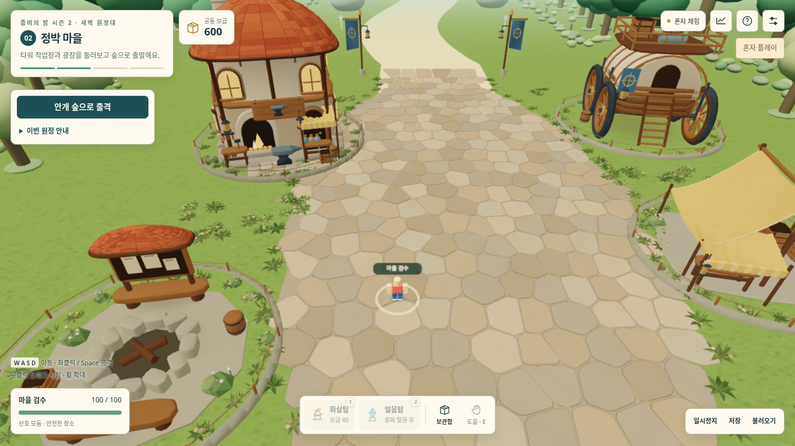
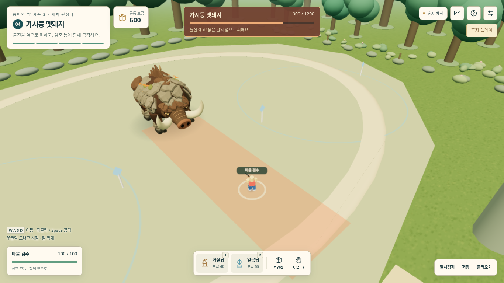

# s2-002 — 새벽 작업장 마을과 가시등 멧돼지

**재작업 전 기록:** 사용자가 이 판의 마을이 시안보다 텅 비어 보인다고 지적했다. 현재 작업은 [s2-003 마을 밀도 개선](s2-003-마을밀도검수.md)을 따른다.

2026-10-13. 선택한 [미술 시안](미술시안/README.md)을 실제 3D로 구현하는 작업이다. 시안 이미지와 실제 렌더 화면을 구분한다. 실행 검수와 성능 비교 결과는 아래에 기록한다.

## 확정 요구와 구현 위치

| 사용자 요구 | 구현 | 검증 |
|---|---|---|
| 마을 A: 붉은 지붕·작업장·노란 천막·이동 요새 | `src/village-a.mjs`의 곡선 지붕, 기와, 화덕, 천막, 바퀴 달린 요새와 광장 | 실제 출발 위치 및 걸어서 접근한 화면 확인 |
| 보스 1: 가시등 멧돼지 | `src/boar-boss.mjs`의 주둥이·곡선 엄니·나무껍질 갑옷·네 다리 | 예고·돌진·경직 자세 및 기존 전투 검사 |
| 캐릭터는 시즌1과 동일 | `src/avatar-season1.mjs` 변경 없음 | 원본 지오메트리·꾸미기·동작 비교 검사 |
| 잘 동작하는 현재 시즌1을 성능 기준으로 사용 | 해상도 0.85·기본 프레임버퍼 AA 유지, 정적 메시 결합·시야 제외·불변 버퍼 | `tests/performance.mjs` 동일 조건 비교 |
| 시즌1 보존 | `클로드/` 실행·배포·저장·설정 변경 없음 | SHA-256 및 변경 경로 확인 |

## 모델과 동작

마을 장식은 공유 불투명 재질 하나와 6개 정적 메시로 결합한다. 4개 접지 음영 메시를 더해 물체가 떠 보이지 않도록 한다. 113,713개 삼각형이며 시작할 때 조명 방향을 꼭짓점 색에 반영한다. 128×128 공유 표면 질감 한 장(기본 64 KiB)을 시작할 때 생성한다. 실시간 광원·그림자 패스·프레임별 행렬 업로드는 추가하지 않는다. 건물별 경계로 화면 밖 건물을 제외한다. 4개 충돌 원은 눈에 보이는 낮은 돌·줄 경계로 표시한다. 바깥쪽 가상 씨앗으로 돌 포장 셀의 크기를 제한해 큰 삼각형으로 튀어나오던 가장자리를 고쳤다. 길가와 건물 사이의 낮은 풀·꽃·잎, 처마·창·기단의 정적 음영을 보강하며 중앙 통로는 비워 둔다.

멧돼지는 11,508개 삼각형, 8개 메시, 재질 2개를 사용한다. 대기 호흡, 예고 중 앞발 긁기와 머리 낮추기, 돌진 네발 달리기, 경직 중 비틀거림을 기존 보스 상태에 연결한다. 공격 판정·피해량·타이밍·이동 속도를 바꾸지 않는다. 자세를 바꿀 때 지오메트리와 색 버퍼를 다시 만들지 않는다.

원래 경고음을 유지하며 코김·발굽 긁기를 더한다. 예고는 최대 5발음, 돌진은 최대 4발음이고, 기존 전체 발음 제한·거리 감쇠·음량·종료 정리를 사용한다. 매 프레임 새 소리나 타이머를 만들지 않는다.

마을 출격 버튼은 그대로 보이게 두고 긴 안내만 기본 접힘으로 바꾼다. 플레이어의 기본 시점을 가리던 면적을 줄인다.

기본 시점에서 작업장·천막·이동 요새가 함께 보이도록 마을 배치를 바꿨다. `VILLAGE_SITES`가 모델과 충돌 좌표의 공통 기준이다. 화면이 다른 이전판과 온라인으로 섞이지 않도록 `BUILD`와 `RELEASE`는 `s2-002`다. 로컬 s2-001 체크포인트는 명시적으로 변환하며, 옮긴 건물 안에 있던 마을 플레이어만 안전한 광장으로 이동시킨다. 보급·타워·꾸미기·전투 위치는 보존한다. 온라인은 모두 새 파일을 열고 새 방 코드를 사용한다.

## 성능 비교 조건과 한계

기준은 시즌1 106차, 이전 시즌2는 커밋 `15a1bb3`다. 숨김 Chromium·SwiftShader, 1366×768, DPR 1, 그리기 배율 0.85, 실제 버퍼 1161×652, 같은 카메라에서 마을은 21명, 전투는 21명·30탑·40적 배치로 비교한다. 서로 다른 월드의 합성 부하이므로 실제 수업 장면과 구별한다. 시즌1의 실제 기본 카메라(FOV 70, 거리 3.2)는 별도 보조 행으로 기록한다. 시즌1에는 같은 원정 보스가 없어 보스 장면은 이전 시즌2와 비교한다.

시즌1의 메뉴 표시는 AA 2지만 중간 화질의 bloom=0 경로는 기본 프레임버퍼의 안티앨리어싱을 사용한다. 이 검사 환경에서 시즌1과 시즌2의 실제 `gl.SAMPLES`는 모두 4다. 시즌2를 별도 2샘플 렌더 타깃으로 바꾸지 않는다.

그리기 호출·삼각형은 실제 렌더에서 기록한다. CPU 갱신 검사와 소프트웨어 WebGL 제출 검사를 구분하며, 이 값을 노트북 FPS나 실제 GPU 개선율로 보고하지 않는다. 사용자 노트북과 실제 21대 온라인 검사는 이 환경에서 수행하지 못한다.

## 최종 성능 결과

동일 카메라·해상도·AA에서 실제로 제출한 렌더 작업이다. 최종 마을 보강 뒤 현재판의 세 장면을 다시 측정하고, 변경 없는 시즌1·이전 시즌2의 기준 행은 소스 해시·화질·개체 수를 대조하여 재사용했다. 실행 시점이 다르므로 **시간 수치의 A/B 개선율은 비교하지 않는다.** 원시 회차·소스 해시·자원 증감·기준 출처는 [performance.json](검수/s2-002/performance.json)에 남긴다.

| 장면 | 시즌1 106차: 호출 / 삼각형 | 이전 시즌2: 호출 / 삼각형 | s2-002: 호출 / 삼각형 |
|---|---:|---:|---:|
| 마을 21명 | 232 / 805,388 | 121 / 311,052 | 108 / 398,101 |
| 전투 21명·30탑·40적 | 317 / 1,123,587 | 109 / 402,112 | 109 / 402,112 |
| 보스 포함 21명·30탑·40적 | 해당 없음 | 80 / 363,646 | 87 / 369,902 |

마을 디테일 추가로 이전 시즌2보다 삼각형은 28.0% 늘고 호출은 10.7% 줄었다. 보스 장면은 삼각형 1.7%, 호출 7회가 늘었다. 마을·일반 전투는 시즌1 비교 장면보다 제출량이 낮다. 시즌1 기본 시점 보조 측정도 마을 255회/849,084개, 전투 340회/1,164,967개다. 이는 서로 다른 장면의 작업량 비교이며 FPS 개선율이 아니다.

마지막 길가 보강 전 [교차 순서 측정](검수/s2-002/performance-alternating-before-edge-refinement.json)에서, 시뮬레이션·통신·WebGL 제출을 제외한 CPU 갱신 중앙값(ms)은 시즌1/이전 시즌2/신형 순서로 마을 0.8/0.4/0.4, 전투 2.0/1.0/1.0이다. 보스는 이전/신형 모두 0.7이었다. 이 교차 측정의 마을은 마지막 식생·길 경계 보강 전 80,496개 삼각형 모델이다. 최종판의 제출량은 위 표와 별도 최종 보고서를 사용한다. **신형 전투 p95는 5.0ms로 이전 3.2ms, 시즌1 4.1ms보다 높았다.** 따라서 모든 시간 지표가 개선됐거나 실기기에서 시즌1보다 빠르다고 단정하지 않는다. 소프트웨어 WebGL 제출 시간은 별도 원시 항목이며 실제 GPU 시간과 구별한다.

신·구 시즌2는 각 장면의 반복 갱신 동안 지오메트리·텍스처 수가 증가하지 않았다. 신형 전투의 개체를 시야 밖으로 옮기면 81회/121,668개로 줄었다. 시즌1 전투는 지오메트리 1개 증가를 관찰값으로 남겼으며, 이 비교에서 기존 시즌1의 자산 수명까지 검증했다고 주장하지 않는다.

## 기존 GitHub 검사 수정

시즌1 106차의 밤 기록은 건물·타워 수를 덧붙여 14열이다. `t79-combat-hud-view.mjs`가 여전히 12열을 기대해 기존 PR 검사에 실패했다. 실행 코드는 그대로 두고 검사에서 14열과 추가 수치를 확인하도록 맞춘다. 예전 12열 저장의 읽기 호환성은 기존 `t106-night-record.mjs`로 확인한다.

## 검수 결과

- `npm test --prefix 시즌2`: **47개 통과**, 실패 0. 시즌1 원본 캐릭터 비교, 멧돼지 형상·버퍼 재사용·정리, 저장 변환, 네트워크 호환성, 1명·21명 정상 행동 완주, Web Audio 검사를 포함한다. [실행 기록](검수/s2-002/unit-tests.txt).
- 최종 독립 HTML 브라우저 검사: **14개 통과**, 오류 0. 입장·꾸미기·실제 이동·현재 저장 및 s2-001 저장 복구·음량·전투 렌더·모의 21명 부하·시즌1 저장 보존을 확인했다. [보고서](검수/s2-002/browser.json).
- 최종 배포본 마을 미술 검사: **5개 통과, 7장 캡처**, 오류 0. 기본 출발·이동·확대·안내 접기·집결지/천막 충돌·작업장·이동 요새·출구를 확인했다. [보고서](검수/s2-002/art-village.json).
- 보스 예고·돌진·경직·각도별 모습과 장면 반복은 마지막 길가 보강 전 **전체 미술 검사 9개/12장**에서 확인했다. 변경하지 않은 보스의 검수 근거로 [당시 보고서](검수/s2-002/art-full-before-edge-refinement.json)와 당시 파일 해시를 보존했다. 마지막 보강은 마을만 변경했으며, 최종 마을 화면은 새 배포본 해시에 연결한다.
- 멧돼지 효과음은 예고 5발음·돌진 4발음, 중복 이벤트 억제, 클리핑 0, 종료 후 노드 0을 확인했다. [음향 수치](검수/s2-002/audio.json). 음색의 주관적 평가는 포함하지 않는다.
- 기존 시즌1 `t79-combat-hud-view.mjs` 및 `t106-night-record.mjs` 검사 통과. 시즌1 원본·배포본 SHA-256은 둘 다 `91c2c21654161390e37d84b70c96d5736f56f07de0add7fea950a0ab15d1173f`로 유지했다.

배포 파일은 924,573바이트이며 SHA-256은 `d8982b945ed5a145b67e112ef800f266ceaf77585045668d4effcdf66189eed7`이다. 아래는 시안 이미지가 아니라 실제 배포 파일의 화면이다. 기본 카메라와 직접 걸어서 접근한 화면을 확인했으며 큰 관통·빈 면·길 이음새 구멍은 발견하지 못했다. 시안의 주요 장소와 세부 요소를 반영했다. 시안의 회화적인 조명·소품 밀도와는 차이가 남아 있다.

[작업장 근접](검수/s2-002/04-workshop-nearby-real-walk.png) · [이동 요새 근접](검수/s2-002/05-caravan-nearby-real-walk.png)

## 실제 사용 확인이 남은 항목

노트북 FPS·발열, 실제 교실 21대 통신, 함께 들었을 때의 음량·음색과 최종 미술 평가는 사용자 테스트가 필요하다. 숨김 Chromium은 독립 HTML을 HTTP로 열어 검사했으며 관리형 환경의 `file://` 제한과 구별한다. Windows 바탕화면에 접근할 수 없어 로컬 파일은 교체하지 않았다. 시즌2 공개 사이트 배포와 PR 병합은 수행하지 않는다.
