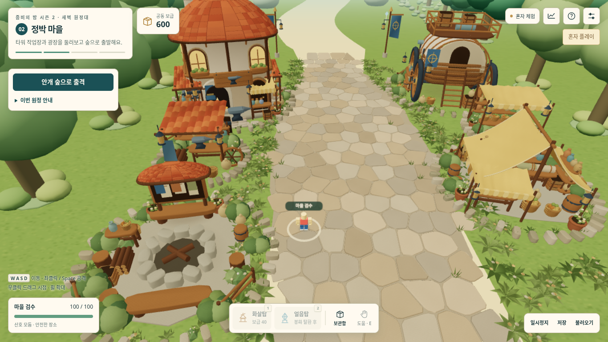

# s2-003 — 연결된 작업장 골목

사용자 피드백: s2-002는 선택한 A 시안보다 마을이 텅 비어 보인다. s2-002 화면은 승인된 최종 미술이 아닌 **재작업 전 비교 자료**로 남긴다.

## 이번 변경과 확인 기준

| 문제 | 구현 | 확인 기준 |
|---|---|---|
| 네 건물이 떨어진 원형 섬처럼 보임 | 건물을 안쪽으로 모으고 공구 작업마당·보급 수레 구역으로 사이를 연결 | 기본 출발 카메라에서 실제 건물 사이 공백 감소 |
| 중앙 포장이 지나치게 넓음 | 중앙 보행 길과 준비 공간에 맞춰 포장을 좁힘 | 21명 출발 위치와 출구 이동 유지 |
| 작은 풀 이외에 중간 높이 소품이 부족 | 차양·공구벽·진열대·바구니·목재·관목 군집 | 실제 작업장/시장 근접 화면에서 크기·겹침 확인 |
| 외곽 잔디가 넓고 비어 보임 | 기존 나무 8개를 건물 뒤로 가까이 재배치하고 낮은 관목으로 연결 | 기본 시점에서 거리의 외곽을 둘러주되 중앙 동선 유지 |
| 성능과 충돌 일치 | 정적 메시 결합, 공통 부지 좌표·숲 장애물 분리 | 시즌1 동일 화질 비교, 6곳 실보행 충돌 |

`VILLAGE_SITES`는 작업장(-10.5,8,r6), 이동 요새(11,5,r6), 집결지(-10,27,r5), 시장(10,21,r5), 공구마당(-11,18,r3.4), 보급마당(13,13.5,r3.1)을 공유한다. 숲 바위는 `FOREST_OBSTACLES`로 분리해 마을 부지가 늘어도 숲 풍경과 장애물은 유지한다.

마을 모델은 228,169삼각형·10개 정적 메시·재질 2개·128² 공유 질감 1개다. 새 작업마당도 기존 메시 묶음에 결합한다. 기존 8개 나무의 호출 수·난수 소비 순서를 보존해 숲 배치를 바꾸지 않는다. 중앙 포장과 북쪽 흙길의 폭도 연결 지점에서 맞춘다.

가까워진 나무 아래에서 잎과 줄기가 캐릭터를 완전히 가리는 결함을 실제 보행 캡처로 발견해 수정했다. 마을 나무의 잎 32개와 줄기 8개를 공유 인스턴스 메시 두 개로 분리한다. 카메라와 캐릭터 사이를 가리는 나무는 잎을 숨기고 줄기를 낮은 그루터기로 표시했다가 복원한다. 매 프레임 최대 32개 구 경계만 계산하고 표시 상태가 바뀔 때만 기존 행렬을 갱신한다. 줄기 충돌·관목·원래 숲은 유지하고, 새 광원·그림자 패스·투명 중첩은 추가하지 않는다.

프로토콜과 배포 표시는 s2-003이다. 로컬 s2-001/s2-002 저장은 진행·자재·꾸미기를 보존해 변환하고, 새 마을 장식에 겹친 위치만 안전한 출발 공간으로 이동시킨다. 온라인 참여자는 모두 새 파일과 새 방 코드를 사용한다. 시즌1 파일·플레이어 모델·음악·보스·전투 규칙·카메라·화질 설정은 변경하지 않는다.

## 검수 결과

최종 독립 HTML은 933,490바이트, SHA-256 `b5fca914aa8936279956bfda1d63b48ecd5917e0f44551bba70e1ae7600128ee`다.

- 최종 Node/Web Audio 검사 **49개 통과**, 실패 0. 실제 21명 출발 배치의 중앙 통로 이동, 6개 부지·8개 줄기 충돌, 1명·21명 정상 입력 원정 완주, s2-001/002 저장 변환을 포함한다. [실행 기록](검수/s2-003/unit-tests.txt).
- 최종 독립 HTML 브라우저 검사 **14개 통과**, 오류 0. 실제 입장·꾸미기·이동·저장, s2-002 저장의 버튼 복구와 새 마당 겹침 해소, 오디오, 21명 모의 전투 렌더와 시즌1 저장 보존을 확인했다. [보고서](검수/s2-003/browser.json).
- 실제 출발·근접·출구·나무 접근·중앙 복귀: **5개 검사 / 8장 캡처, 실행 오류 0**. [최종 미술 보고서](검수/s2-003/art-village.json)의 실행 파일 해시가 최종 배포본과 일치한다. 자동 통과와 별도로 이미지를 직접 열어 확인했다.
- 6개 건물/작업마당의 실보행 충돌과 줄기 2곳 충돌은 [가림 처리 전 전수 보고서](검수/s2-003/art-collisions-before-canopy-fix.json)에 남겼다. 이 판에서는 수관 가림 결함을 발견했으므로 자동검사 통과를 미술 승인으로 해석하지 않는다. 마지막 변경은 나무의 보이는 모습만 조정했으며, 최종판에서 양쪽 나무 충돌·가림·복원을 다시 확인했다.
- 최종 기본 시점에서 작업장→공구마당→집결지와 이동 요새→보급마당→시장이 한 거리로 이어진다. 근접 화면에서 처마·기와·진열대·천막·바구니·포장 경계를 확인했다. 두 나무 뒤에서는 머리·어깨·이름이 보이며 낮은 관목이 하체 일부를 가린다. 중앙으로 복귀하면 수관과 줄기가 복원된다.
- 시즌1 원본과 배포본 SHA-256은 둘 다 `91c2c21654161390e37d84b70c96d5736f56f07de0add7fea950a0ab15d1173f`로 유지했다. 시즌1 캐릭터·꾸미기·동작 모듈도 변경하지 않았다.

[작업장 근접](검수/s2-003/04-workshop-nearby-real-walk.png) · [이동 요새 근접](검수/s2-003/05-caravan-nearby-real-walk.png) · [외곽에서 돌아온 화면](검수/s2-003/06c-village-grove-restored-real-walk.png)

## 시즌1 기준 성능

숨김 Chromium·소프트웨어 WebGL, 1366×768, DPR 1, 그리기 배율 0.85, 실제 버퍼 1161×652와 native MSAA 4를 유지했다. 카메라·개체 배치는 [직전 검수](s2-002-미술성능검수.md)의 조건과 같다. 최신 소스의 세 장면을 다시 측정하고, 시즌1·직전판은 변경되지 않은 소스 해시를 검증해 기존 기록을 재사용했다. 별도 실행의 시간값으로 FPS나 속도 개선율을 계산하지 않는다.

| 장면 | 시즌1 106차: 호출 / 삼각형 | s2-002: 호출 / 삼각형 | s2-003: 호출 / 삼각형 |
|---|---:|---:|---:|
| 마을 21명 | 232 / 805,388 | 108 / 398,101 | 110 / 516,589 |
| 전투 21명·30탑·40적 | 317 / 1,123,587 | 109 / 402,112 | 109 / 402,112 |
| 보스 포함 21명·30탑·40적 | 해당 없음 | 87 / 369,902 | 87 / 369,902 |

마을은 직전판보다 삼각형 29.8%, 호출 2회가 늘었지만 시즌1 비교 장면의 호출 47.4%·삼각형 64.1% 안에 있다. 전투·보스의 제출량은 직전판과 동일하다. 세 장면 모두 반복 검사에서 지오메트리·텍스처 증가 0이며, 전투 개체를 화면 밖으로 옮기면 81회/121,668개로 감소한다. 측정된 현재 소스 15개 해시도 최종 소스와 일치한다. [원시 성능 기록](검수/s2-003/performance.json).

이는 실제 수업을 재현한 성능 보장이 아니라 고정 합성 장면의 그리기 작업량 비교다. 특히 과거와 동일한 마을 비교 격자를 유지한 결과 가상 플레이어 2명이 새 부지와 겹친다. 보고서의 `blockedFixturePlayers`에 기록했으며, 실제 출발 위치에서 21명이 통로를 이동하는 별도 시뮬레이션 검사와 구분한다.

## 실제 사용 확인이 남은 항목

배치의 빈 공간은 줄였으나 시안 A의 회화적인 조명·유기적인 식생과 실제 3D 화면에는 차이가 남아 있다. 최종 미술 평가는 사용자 테스트로 확인한다. 실제 노트북 FPS·발열·교실 21대 통신은 이 환경에서 측정하지 않았다. Windows 바탕화면에 접근할 수 없어 로컬 파일을 교체하지 않았으며, 시즌2 공개 사이트 배포와 PR 병합은 수행하지 않는다.
