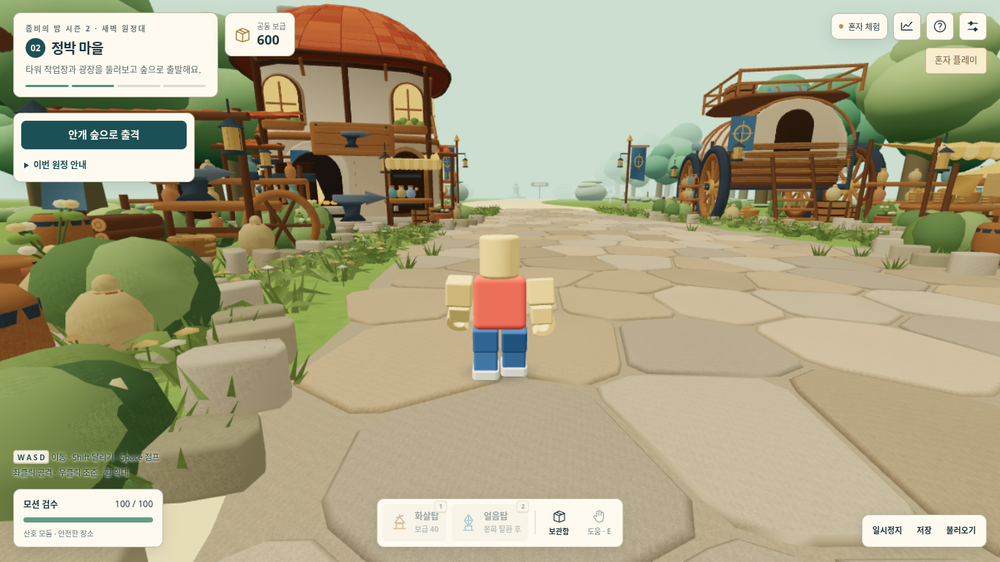

# s2-004 — 시즌1 모션·카메라 복원

이번 변경은 사용자 최종 요청에 따라 **1번: 시즌1 실제 조작·모션·카메라 복원**만 포함한다. 마을 구조물과 기존 미술 자산은 s2-003 그대로다.

| 요구 | 구현 | 확인 |
|---|---|---|
| 시즌1 캐릭터·동작 | 원본 모델·꾸미기 유지. 걷기 5.94, 가감속40, 달리기1.45배, 기력3초/4초, 점프·2단 공중제비·착지·걸음 위상 연결 | 원본 함수 실행으로 프레임별 상태와 실제 렌더 행렬 비교 |
| 시즌1 카메라 | FOV70, 기본거리3.2, 감도.0024, 어깨 조준, 휠1인칭, 수평 지연 없는 추종, 점프·착지 반동, 대기실 거리4.4 | 원본 카메라260프레임 위치·회전·FOV 비교, 실제 입력 화면 |
| 멀티플레이 이동 | 60Hz 호스트 이동, 같은 함수의 게스트 예측, 원본 친구8점 보간. 입력20Hz·스냅샷10Hz 유지 | 실제 입력/스냅샷 전송 경로·짧은 점프 순번·지연 교정 검사 |
| 시즌1 수준 성능 우선 | 화질/해상도 유지, 고정 버퍼·캐시 재사용, 반복 GPU 자산 생성 없음 | 같은 기본 카메라·화질·21명 합성 장면의 시즌1/시즌2 신규 비교 |
| 시즌1 보존 | 시즌2만 변경, 기존 로컬 저장 변환, 온라인 버전 분리 | 시즌1 두 파일 SHA와 저장 sentinel 검사 |

## 적용과 범위

`locomotion-season1.mjs`, `camera-season1.mjs`, `presentation-season1.mjs`와 원본 추출 도구에 **106차** 기준과 원본 SHA를 기록했다. 원본의 성곽·계단·경주·비행·관전 전용 로직과 총기 전투 전체는 이식 범위가 아니다. 원정 공격·타워·피해·보상 규칙은 유지한다. 점프가 건물 충돌이나 공격 피해를 우회하지 않는다. 대기실은 단일 점프, 원정은 2단 공중제비가 가능하다.

좌클릭은 공격/시점 잠금, Space는 점프, Shift는 달리기, 우클릭은 어깨 조준 시점, 마우스는 회전, 휠은 줌/1인칭이다. 잠금을 사용할 수 없으면 우클릭 드래그로 시점을 돌린다. Esc는 잠금/설치 선택을 해제한다. 검사는 `pw.mjs` 숨김 브라우저로만 수행해 운영체제 마우스를 움직이거나 잠그지 않는다.

가까워진 카메라에서 자기 이름표가 시야를 가려 로컬 이름표와 상시 발밑 고리를 제거했고 친구 이름표는 화면 크기를 제한했다. 쓰러짐 `hp=0`을 원본 카메라에 연결했다. 체크포인트 복원은 점프 입력 순번을 되돌리지 않고, 게스트도 호스트의 확인 순번을 반영한다. 일시정지 중 점프 입력은 재개 후 실행되지 않는다. 게스트 예측은 화면 속도와 무관한 1/60초 누산기로 저FPS 점프 궤적을 보존한다.

## 검수

- Node/Web Audio **82개 통과**, 실패0. 원본 수치·행렬, 저장 변환, 통신 왕복, 1명·21명 원정 완주 포함. [실행 기록](검수/s2-004/unit-tests.txt).
- 최종 독립 HTML: **947,461바이트**, SHA-256 `44d521de1a3daeefafefea932e3a42498266c1f29a3632eaafabe0aac313c3fa`.
- 독립 HTML 기능 브라우저 **14개 통과**, 오류0. 실제 입장·꾸미기·이동·저장/복구, 숲/보스 및21명 합성 렌더, 오디오와 시즌1 저장 보존 확인. [보고서](검수/s2-004/browser/report.json).
- 최종 실제 키보드·마우스 검사 **9개 통과**, 오류0, 사진8장/157프레임. 걷기·달리기·기력·점프·공중제비·착지·조준·1인칭·입력 해제를 확인했다. [보고서](검수/s2-004/motion/report.json)의 실행 HTML 해시가 최종 배포본과 일치한다. 기본 마을·공중제비·1인칭 사진을 직접 열어 확인했다.

[공중제비](검수/s2-004/motion/04-village-double-jump-flip.png) · [1인칭](검수/s2-004/motion/07-village-first-person.png)

### 시즌1 기준 성능

1366×768, DPR1, 그리기.85(실제1161×652), native MSAA4, FOV70·pitch-.22·거리3.2·발높이+.80 카메라를 두 판에 동일하게 설정했다. 21명·30타워·40적의 실제 중심 배열을 대조하고, 원본 시즌1과 현재 시즌2를 3회×120프레임 새로 측정했다. 과거 상공 카메라 보고서 수치는 가져오지 않았다. [전체 보고서](검수/s2-004/performance/performance.json).

| 합성 장면 | 시즌1 106차 호출 / 삼각형 | s2-004 호출 / 삼각형 |
|---|---:|---:|
| 마을21명 | 246 / 824,608 | 135 / 527,035 |
| 전투21명·30타워·40적 | 330 / 1,126,903 | 100 / 375,526 |
| 보스 포함21명·30타워·40적 | 해당 없음 | 78 / 352,710 |

시즌2의 지오메트리·텍스처 증가0, 화면 밖 전투 개체 제외를 확인했다. 마을의 기존 비교 격자는 일부 구조물과 겹치는 가상 인원을 포함하며 보고서의 `blockedFixturePlayers`로 구분한다. 실제 플레이 출발·이동 검사는 별도로 수행한다. CPU 표본은 시뮬레이션/통신과 WebGL 제출을 제외한 화면 갱신 작업이며 실제 수업 프레임 시간을 뜻하지 않는다.

## 실제 사용 확인이 남은 항목

자동 검사는 실제 노트북 FPS·발열과 교실21대 통신을 대신하지 않는다. 성능 수치는 소프트웨어 렌더러의 작업량 비교이며 실제 GPU 시간/FPS 향상을 주장하지 않는다. 최종 조작감은 사용자 테스트가 필요하다.

관리형 Chromium이 `file://` 열기를 `ERR_BLOCKED_BY_ADMINISTRATOR`로 차단했다. 이 환경에서는 같은 독립 HTML을 로컬 HTTP로 제공해 검사한다. Windows 바탕화면에는 접근할 수 없어 파일을 교체하지 못했다. GitHub PR과 공개 사이트 배포는 구분한다.

시즌1 원본·배포용 SHA-256은 모두 `91c2c21654161390e37d84b70c96d5736f56f07de0add7fea950a0ab15d1173f`로 유지했다.
