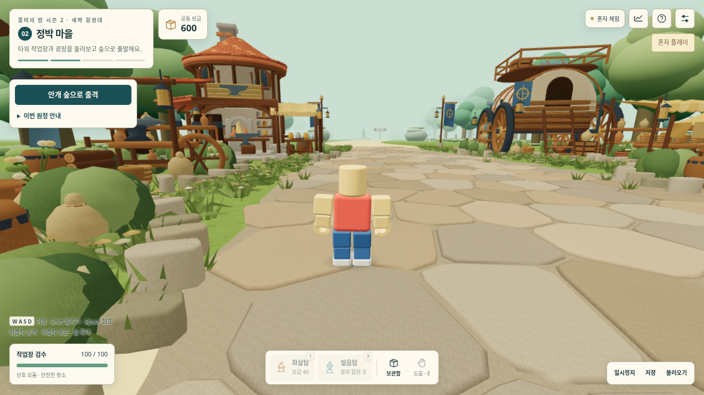
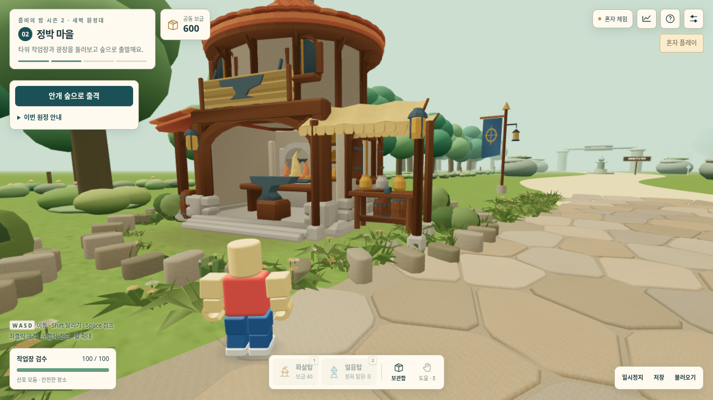

# s2-005 — 첫 마을의 3D Jutsu 작업장

사용자가 지정한 **② 작업장 한 채 상세 제작 → 실제 화면·시즌1 기준 성능 확인 → 나머지 마을 확대** 순서의 첫 적용이다. 마을 전체 교체나 새 던전 구현까지 끝낸 판은 아니다. 첫 마을 검수 뒤 다른 구조물, 그다음 던전을 하나씩 제작한다.

## 요구와 적용

| 요구 | 구현 위치 | 검수 근거 |
|---|---|---|
| 상자를 쌓은 외형 대신 입체적인 작업장 | `assets/workshop.glb`, `tools/workshop-jutsu/01~04` | 굽은 기와 처마·두께 있는 목재 골조·열린 대장간·낮은 부속 작업실·겹친 천 차양·옆 창과 덧문을 정면/측면 실제 게임 화면에서 확인 |
| 작은 물건과 작업장 내부의 깊이 | 같은 GLB의 작업대·모루·항아리·도구·통·등·정적인 화로 불꽃 | 실제 기본 카메라로 걸어 접근한 사진, 내보내기 후 접촉 음영의 비상수 범위 확인 |
| 시즌1 캐릭터·모션·카메라 유지 | 기존 `avatar/locomotion/camera/presentation-season1` 사용 | 해당 코드 무변경, 원본 대조를 포함한 전체 자동 검사와 실제 이동/우클릭 시점 검사 |
| 성능을 우선하며 상세 추가 | `tools/import-workshop-glb.mjs`, `src/workshop-model.mjs`, `src/village-a.mjs` | 모델을 기존 작업장 묶음에 합침. 추가 그리기 묶음·재질·텍스처·조명·프레임별 갱신 0 |
| 다른 마을 구조물 보존 | 기존 마당·수레·시장·집결소 유지 | [정점 버퍼 비교](검수/s2-005/preserved-village-buffers.json): 작업장을 제외한 9개 묶음의 위치/색/UV가 이전판과 동일 |
| 시즌1 보존, 시즌2에 별도 적용 | `시즌2/` 안에서만 변경 | 시즌1 원본·배포용 SHA 동일, 기존 배포 설정 무변경 |

## 제작과 가져오기

새 [Higgsfield 3D Jutsu 프로젝트](https://higgsfield.ai/3d-jutsu/b579a3b5-2650-4328-b4ec-b38c60aec6e3)의 **revision 4**에서 제작했다. 의미별 부품 562개를 수정 가능한 원본에 보존하고, 게임용 GLB는 공용 불투명 재질 8개로 묶었다. 취소된 옛 작업장 시안을 복원한 것이 아니다. 재현 절차는 [제작 원본 안내](tools/workshop-jutsu/README.md), 치수·해시·출처는 [자산 명세](assets/workshop.manifest.json)를 따른다.

모델은 25,336삼각형, 높이 8.723m, 평면 반경 5.468m다. 작업용 바닥·카메라·조명·애니메이션·외부 텍스처를 포함하지 않는다. 천은 실제 두께를 가지며 게임 전체의 양면 렌더링을 켜지 않는다. 건물은 기존 충돌 구역 안에 들어가고, 열린 전면은 미술 표현이다. 건물 내부 입장 기능이나 새 상호작용을 추가하지 않았다.

내보내기 검수에서 Blender가 실제 접촉 음영을 `COLOR_1`, 흰 기본 채널을 `COLOR_0`로 내보내는 문제를 발견했다. 정적 묶음 도구가 실제 음영을 `COLOR_0`로 옮기며 값의 범위 **0.462~1.0**을 검사한다. 게임은 이를 재질 색·기존 태양 방향 음영에 곱해 굽는다. 추가 실시간 그림자나 조명은 없다.

`npm run build`가 GLB를 검증하고 밀리미터 위치·정점 색·인덱스를 단일 HTML에 포함한다. 게임 실행 중 별도 GLB 요청이나 로더는 없다. 생성된 모델 데이터를 직접 편집하지 않는다. 최종 독립 HTML은 **1,914,839바이트**로, 이전 947,461바이트보다 커졌다. 다운로드 크기와 매 프레임 렌더링 작업량은 구분한다.

표시 버전은 **s2-005**, 저장·통신 규격은 **s2-004**를 유지한다. 이동·전투·저장·방 권한·충돌 규칙이 바뀌지 않는 미술 변경이다. 네 직업·다섯 던전·층별 포탈·모둠별 전투와 합동 보스는 여전히 미구현이다.

## 실제 화면 확인

숨김 Chromium에서 대기실 입장 후 실제 WASD로 마을 출발 → 작업장 정면 → 측면 → 북쪽 출구를 이동했다. 시점은 시즌1 카메라이며 근접 처마/측면 사진은 실제 우클릭 드래그로 회전했다. 모델을 따로 전시한 조망 카메라로 이 검사를 대체하지 않았다.





[처마 아래](검수/s2-005/workshop/04-workshop-front-eaves-real-camera.png) · [옆면과 창](검수/s2-005/workshop/06-workshop-east-side.png) · [기존판 정면](검수/s2-005/baseline/04-workshop-front-eaves-real-camera.png)

기와가 원래 지붕 밑판에 가려진 부분과 비어 보이던 옆벽은 제작 중 수정했다. 최종 실제 화면에서 차양 두 겹, 처마의 두께, 화로·작업대, 측면 창과 목재 버팀대를 직접 확인했다. 사용자 최종 미술 승인을 대신하는 평가는 아니다.

## 자동 검사와 성능

- Node/Web Audio **86개 통과**, 실패 0. [실행 기록](검수/s2-005/unit-tests.txt).
- 새 모델 검사 **4개 통과**: 원본 변환 재현, 잘못된 자산 거절, 실제 정적 묶음의 모든 모델 정점/색/UV, 흰 채널로 유실되지 않은 접촉 음영. [기록](검수/s2-005/workshop-model-tests.txt).
- 실제 이동·충돌·시점, 반복 구간 전환, 단일 HTML 오프라인 실행 **7개 통과**, 오류 0. [브라우저 보고서](검수/s2-005/workshop/report.json)의 최종 HTML/모델 해시가 작업 파일과 일치한다. 보조 합성 검사에서 마을·숲·보스 5회 반복 전환 전후 지오메트리 34개·텍스처 6개로 누적이 없었다.
- 마을 정적 미술 전체 삼각형은 **228,169 → 213,557**, 정점 버퍼는 **21,890,400 → 20,487,648바이트**다. 기존 10개 묶음·2개 재질·1개 텍스처·0개 조명·프레임별 갱신 0을 유지한다. [현재 기하 자료](검수/s2-005/geometry.json).

같은 화질의 21명 합성 장면은 [성능 보고서](검수/s2-005/performance/performance.json)와 변경 전 [s2-004 기준](검수/s2-005/baseline/performance.json)에서 비교한다. 1366×768, DPR1, 그리기 0.85, native MSAA4, FOV70·pitch−0.22·거리3.2의 시즌1 기본 카메라를 사용한다. 원본 시즌1과 현재판을 각각 3회×120프레임 새로 측정한다. 합성 격자의 일부 인원은 구조물과 겹칠 수 있어 실제 이동 검사를 별도로 수행했다.

| 21명 마을 합성 장면 | 그리기 호출 | 삼각형 |
|---|---:|---:|
| 시즌1 106차 | 246 | 824,608 |
| 변경 전 s2-004 | 135 | 527,035 |
| 작업장 적용 s2-005 | 135 | 512,423 |

동일 비교 시점의 호출 수는 그대로이고 삼각형은 이전 시즌2보다 **14,612개(약 2.8%) 감소**했다. 이번 변경의 성능 비교 범위는 마을이다. 전투/보스의 전체 성능 재측정이나 새 RPG 인스턴스 분리 검증으로 확대 해석하지 않는다.

재현 명령(저장소 루트, Playwright 경로는 환경에 맞게 지정):

```sh
npm --prefix 시즌2 run build
npm --prefix 시즌2 test
node 시즌2/tests/workshop-model.test.mjs
S2_WORKSHOP_OUTPUT=시즌2/검수/s2-005/workshop node 시즌2/tests/workshop-browser.mjs
S2_PERF_SCENARIOS=village S2_PERF_OUTPUT=시즌2/검수/s2-005/performance node 시즌2/tests/performance.mjs
```

## 미확인 범위와 전달

**실제 노트북 FPS·GPU 시간·발열 및 교실 21대 동시 통신은 미측정**이다. 소프트웨어 렌더러의 호출·삼각형 수를 실제 FPS 향상으로 보고하지 않는다. 원격 EEVEE 렌더는 생성·조회했지만 커넥터가 URL만 반환해 원격 이미지 자체는 열어 보지 못했다. 내려받은 정확한 GLB의 로컬 렌더와 최종 게임 화면은 직접 확인했다.

관리형 Chromium은 `file://`를 차단한다. 따라서 최종 HTML 원문 한 개만 메모리에서 제공하고 네트워크가 꺼진 브라우저 컨텍스트로 오프라인 기능을 검사한다. 이는 이 환경에서 Windows 파일 더블클릭까지 확인했다는 뜻이 아니다. Windows 바탕화면에는 접근할 수 없어 복사하지 못했다. GitHub 작업 브랜치·PR은 공개 배포와 구분한다.

시즌1 원본·배포용 SHA-256: `91c2c21654161390e37d84b70c96d5736f56f07de0add7fea950a0ab15d1173f`.

최종 시즌2 HTML SHA-256: `da061dd55dd7d253107fb027cff51e553fdb00c5b2380836ad29870e80729ca4`.
