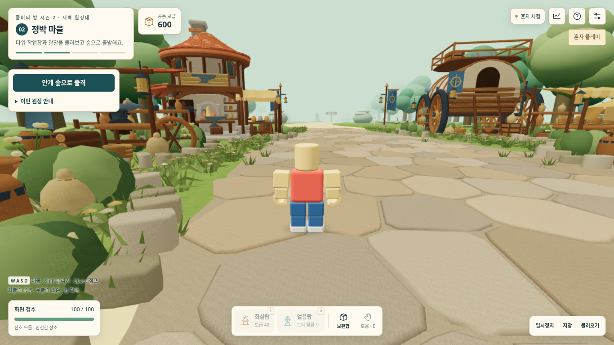
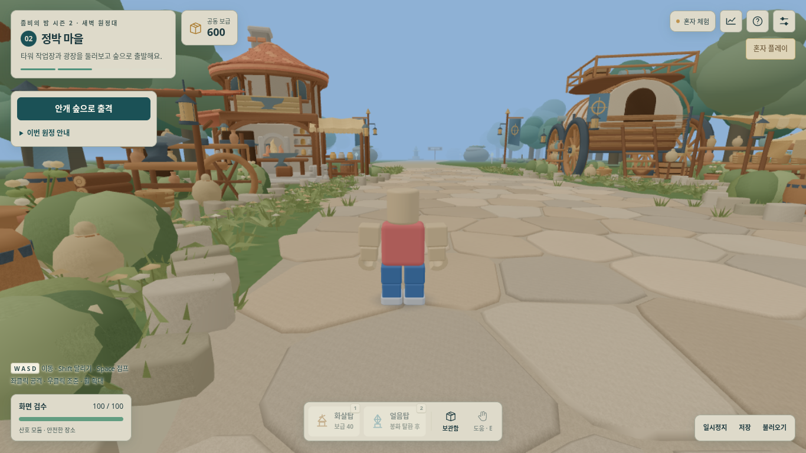
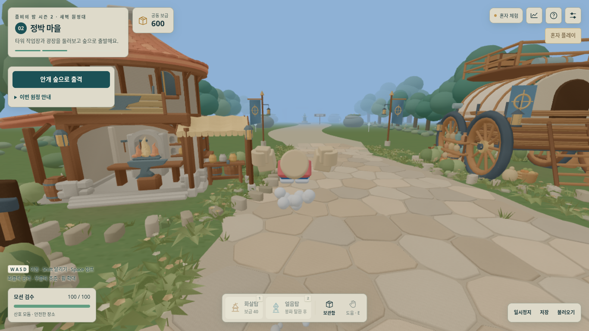
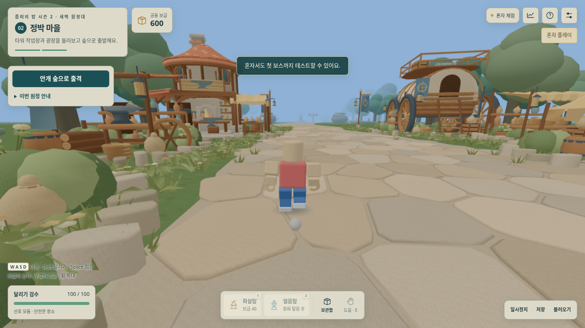

# s2-006 — 시즌1 기준 밝기와 동작 연결

2026-10-14. 다른 마을 건물을 제작하기 전에, 시즌1보다 밝고 눈이 불편하다는 피드백과 달리기·2단 점프의 누락된 연결을 보완한다. s2-005 작업장과 맵·시즌1 원본은 그대로다.

## 밝기와 색 처리

안티앨리어싱은 경계의 계단 현상을 완화한다. 이번 차이는 주로 시즌2의 **ACES 노출 1.22**, 강한 조명, 밝은 연녹색 하늘과 크림색 HUD에서 확인했다. 시즌1은 **AgX 노출 1.28**을 사용한다. 노출 숫자만 비교하지 않고 같은 실제 시점의 출력 이미지를 비교했다.

- [graphics-season1.mjs](src/graphics-season1.mjs)는 시즌1 106차의 `TONE`, `LIGHT_D`, `LIT_K`, `HEMI_DS/HEMI_DG`, `SUN_D`를 따른다. AgX가 없을 때는 원본처럼 Linear 1.15를 사용한다. 현재 고정된 Three r160에는 AgX가 있다.
- 주변광은 선형 색 공간에서 기존 반구광의 위·아래 색에 합쳐 같은 방향별 빛을 유지한다. 장면 조명은 기존 2개 그대로다. 햇빛 세기는 2.5에서 시즌1 기준 0.714로 조정했다. 새 전체 화면 필터·후처리·빛 번짐은 없다.
- 하늘/안개를 차분한 색으로 맞추고, HUD 종이색은 `#fffaf0 → #dedaca`로 낮췄다. 작은 글자는 더 짙게 조정해 읽기 쉬운 대비를 확보했다. 건물 재질·모델 디테일을 삭제하거나 화면을 흐리게 처리하지 않았다.
- 그리기 배율 **0.85**, 실제 렌더 **1161×652**(1366×768/DPR1 검사), native **MSAA4**를 유지했다.

[변경 후 작업장](검수/s2-006/comfort/current/03-workshop-front-default-pitch.png) · [실제 숲 출격](검수/s2-006/comfort/current/04-forest-actual-departure.png) · [보조 보스 경고 장면](검수/s2-006/comfort/current/05-boss-warning-fixture.png)

전후 각각 실제 대기실 입장 → 마을 → WASD로 작업장 접근 → 숲 출격을 수행했고, 보스 경고만 별도로 표시한 합성 장면이다. 같은 입력/시점의 캡처를 직접 열어 구조물·캐릭터·안내 글자·위험 구역의 구분을 확인했다. 주요 HUD 사각형을 제외한 선형 sRGB 평균 휘도는 마을 **0.3889 → 0.2967**, 작업장 **0.3982 → 0.2847**이었다. 작은 우측 아이콘 등 약 0.5%의 HUD는 이 마스크에 남는다. 이는 이미지 출력의 밝기 지표이며 실제 눈의 편안함을 측정한 값은 아니다.

## 달리기·2단 점프에서 실제로 빠졌던 부분

기본 Shift 달리기·기력·Space 점프·2단 공중제비의 물리와 캐릭터 함수는 s2-004부터 있었다. 해당 코드를 새로 만들거나 이동 수치를 바꾸지 않고, 실제 플레이에서 끊겨 있던 부분을 연결했다.

| 발견한 문제 | 수정 | 확인 |
|---|---|---|
| 설정의 시점 초기화, 도움말/보관함 닫기 등의 버튼에 키보드 초점이 남아 이동 키가 차단됨 | 동작 완료·패널 닫기 뒤 게임 캔버스에 초점 복귀. 입력칸/선택상자/음량 슬라이더의 키보드 조작은 유지 | 테스트용 `canvas.focus()` 없이 실제 UI 클릭 직후 이동·달리기·점프 검사 |
| 점프/2단 점프 순간의 시즌1 시야 반응과 달리기·착지 입자 연결 누락 | 원본의 작은 FOV 반응, 달리기 먼지·점프 꼬리·착지·제동 효과 연결 | 실제 입력 캡처와 `motion-feedback-season1`의 제한/정지 검사 |
| 친구의 위치 보간 후 `take/land/flip`을 항상 0으로 지움 | 기존 스냅샷의 자세를 원본 8점 위치 보간의 표시 시점에 맞춤 | 지연된 공중제비, 반복 패킷, 대기 후 이동 시 옛 착지가 재생되지 않는 회귀 검사 |
| 점프·2단 점프·착지 이벤트가 소리 처리에서 무시됨, 발소리 연결 없음 | 원본 효과음과 로컬 보행 주기 연결, 기존 효과음 음량·중복 제거·동시 재생 제한 사용 | 실제 Web Audio 렌더·음소거/일시정지·21회 반복 이벤트·종료 정리 검사 |

대기실의 단일 점프·달리기 제한은 시즌1 그대로다. **마을과 원정에서 Shift+이동으로 달리고, Space를 다시 눌러 2단 공중제비를 한다.** 경주·비행 등 별도 게임 모드의 동작을 가져온 것은 아니다.

원격 자세는 새 서버 필드 없이 시즌2가 이미 보내던 상태를 사용한다. 원본 `friendSeg/friendLerp` 위치 함수는 그대로 두고 어댑터에 연결했다. 검토 중 찾은 ‘오래 서 있다가 다시 걸으면 끝난 착지 동작이 재생되는 현상’도 수정했다. 세 번의 2단 점프와 사이의 긴 대기를 독립적으로 재생해 새 점프가 빠지거나 오래된 동작이 재생되지 않는 것을 확인했다.

위 화면은 카메라·위치를 강제로 지정하지 않고 실제 키 입력으로 촬영했으며 직접 열어 공중제비의 뒤집힌 자세, 달리기의 보행 자세와 먼지를 확인했다. 관리형 브라우저가 `file://`를 차단하므로 최종 HTML을 loopback으로 로드한 뒤 네트워크를 끊고 입장했다.

## 비용 제한과 검사

- 달리기·점프·착지 효과는 로컬 캐릭터를 추적하고, 원본 캐릭터의 제동 먼지도 같은 **64개 불투명 입자 풀**을 공유한다. 기존 작은 인스턴스 묶음에 그리며 새 조명·텍스처·재질·후처리 패스를 만들지 않는다. 정지 장면에서는 추가 호출이 없다. 동작 중에는 작은 묶음 최대 1회가 추가될 수 있다.
- 소리는 기존 **24개 SFX 슬롯**과 노드 정리 경로를 사용한다. 친구 21명의 발소리를 매 프레임 새로 보내지 않으며 멈춤·공중·쓰러짐·순간이동·음소거·일시정지 뒤 몰아 재생하지 않는다. BGM은 유지했다.
- 전체 Node/Web Audio **90개 통과**, 실패 0: [기록](검수/s2-006/unit-tests.txt).
- 전후 시각 검사 각각 **5개 통과**: [이전판](검수/s2-006/comfort/baseline/report.json), [현재판](검수/s2-006/comfort/current/report.json). 같은 시점 호출/삼각형 수는 모든 비교 장면에서 동일했다. 핵심 HUD 글자 대비는 5.07~8.40, 체력 설명은 4.33에서 5.18로 개선했다.
- 배포 HTML의 실제 키/마우스/UI 입력 **10개 통과**: [동작 보고서](검수/s2-006/motion/report.json). 별도 상태 주입 없이 대기실 → 마을에 들어가 실제 Shift 달리기를 확인했다: [달리기 보고서](검수/s2-006/motion/sprint-report.json). 8.60m/s 이동, 보행 위상 1.034, 시야각 77°, 입자 1/64개, 정지 대비 호출 +1회를 관찰했다. 테스트 코드는 [전체 조작](tests/motion-browser.mjs), [달리기 캡처](tests/motion-sprint-browser.mjs)에 있다.
- 동작 소리 실제 렌더 [4초 샘플](검수/s2-006/audio/movement.wav)과 [수치](검수/s2-006/audio/metrics.json). 최대 효과음 음량에서 클리핑 0, 재생 종료와 음성 수 제한을 확인했다. 주관적 청음 평가는 하지 않았다.

## 시즌1과 같은 화질의 21명 장면

[성능 보고서](검수/s2-006/performance/performance.json)는 같은 기본 카메라·그리기 배율 0.85·MSAA4에서 시즌1 원본과 현재판을 새로 실행한 결과다. 마을은 21명, 전투/보스는 21명+타워 30개+적 40개로 고정했다. 이번 밝기·동작 수정의 비용 비교용 **합성 정지 장면**이며 21대가 접속해 이동하는 교실 검사는 아니다. 새 RPG 최종 합동 보스전도 아직 구현하지 않았다.

| 장면 | 시즌1 호출 / 삼각형 | 시즌2 호출 / 삼각형 |
|---|---:|---:|
| 마을 | 246 / 824,608 | 135 / 512,423 |
| 전투 | 330 / 1,126,903 | 100 / 375,526 |
| 현재 첫 보스 | 대응 장면 없음 | 78 / 352,710 |

현재판은 비교 가능한 마을·전투의 시즌1 호출/삼각형 예산 안에 있다. 자원 수가 계속 늘어나지 않고, 화면 밖 인물을 제외하면 제출 삼각형이 줄어드는 것도 확인했다. 이 수치나 SwiftShader의 CPU/제출 시간은 실제 그램 FPS가 아니다. 동작 중 입자 비용은 위 실제 달리기 검사에서 별도로 확인했다.

재현은 저장소 루트에서 `PW_MODULE`과 `PW_EXECUTABLE_PATH`를 지정하고 `S2_PERF_OUTPUT=시즌2/검수/s2-006/performance node 시즌2/tests/performance.mjs`로 실행한다. 실제 조작은 `node 시즌2/tests/motion-browser.mjs`, 시각 비교는 `node 시즌2/tests/comfort-browser.mjs`, 단위 검사는 `npm --prefix 시즌2 test`로 수행한다. 각 브라우저 검사의 출력 경로/번들 설정은 해당 파일 상단에 있다.

전체 조작 검수 뒤 도움말에서 마을의 달리기·2단 점프 규칙을 명확히 했다. [문구만 변경된 증거](검수/s2-006/help-copy-only.json)에 원본/결과 해시와 번들의 정확한 문자열 치환 일치를 남겼다. 최종 번들에서도 [도움말 열기 → 닫기 → 추가 클릭 없이 달리기 검사](검수/s2-006/final-smoke/sprint-report.json)를 통과했다. [도움말 화면](검수/s2-006/final-smoke/00-final-help.png)의 줄바꿈·가독성을 직접 확인했다. 최종 배포 HTML은 **1,921,413바이트**, SHA-256 `3fbf7bbc3752b7850747aae6b15500b7d6a63856db92a98edc90a878685380b5`다.

저장·통신 규격은 **s2-004**, 표시 버전은 **s2-006**이다. 새 클래스·던전·층별 포탈·합동전은 이번 범위에 없다. 시즌1 원본·배포용 SHA-256은 모두 `91c2c21654161390e37d84b70c96d5736f56f07de0add7fea950a0ab15d1173f`, 작업장 GLB는 `04138dea5fb8c9971d91d565689c0eb9b7b30d30132b70732b8c70c8512f50cc`로 유지했다.

## 실제 확인이 남은 범위

숨김 브라우저는 실제 노트북의 눈부심·발열·FPS나 교실 21대 동시 통신을 대신하지 않는다. 사용자의 시즌1과 같은 기기에서 최종 밝기와 조작감을 확인해야 한다. Windows 바탕화면에는 접근할 수 없어 파일을 복사하지 못했다. GitHub 작업 브랜치·PR과 공개 사이트 배포는 구분한다.
