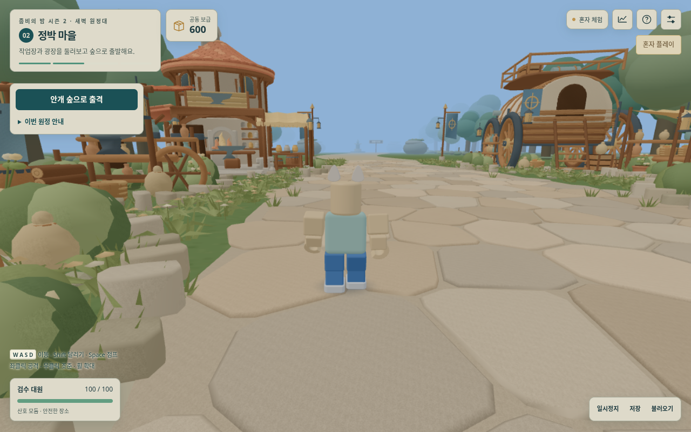

# s2-007 — 공용 타워 기능과 안내 제거

2026-10-14. 사용자가 타워를 발명가 전용 스킬로 한정했으므로 현재 테스트판의 공용 배치·포장·수리·보관함 기능과 관련 안내를 제거했다. 직업을 구현한 판은 아니므로 현재는 누구도 타워 스킬을 사용하지 않는다. [s2-006 밝기·시즌1 동작 연결](s2-006-화면모션검수.md)과 상세 작업장 모델은 유지한다.

## 구현

| 요청 | 반영 위치와 동작 |
|---|---|
| 공용 타워 조작 제거 | `src/app.mjs`, `src/ui.mjs`: 1/2/T/R 단축키·선택·클릭 배치·보관함·포장/수리 버튼 삭제. 좌클릭은 기본 공격, E는 봉화·친구 구조·보스 입구 상호작용 |
| 관련 도움말 제거 | 이동·달리기·점프·공격·조준 도움말은 유지하고 타워 조합/설치 설명, 원정·승리·실패 문구를 정리. 페이지 메타 설명도 탐험/공략으로 변경 |
| 배치 화면 제거 | `src/scene.mjs`: 배치 미리보기·사거리 원·파란 설치 지대·해당 깃발 삭제. 보스 돌진 경고는 유지 |
| 실제 공용 기능 차단 | `src/sim.mjs`: build/pack/deploy/repair 판정·포장/설치 진행·운반 이동/공격/구조 제한 제거. 예전 요청을 직접 보내도 거절 |
| 예전 타워의 재등장 방지 | `src/save.mjs`: 저장 복제본의 towers와 재도전 towers를 비움. 시작·재도전·승리·귀환에도 옛 타워를 복원하지 않음 |

일반 공격·적/보스 수치·캐릭터 물리·카메라·현재 조명·효과음은 바꾸지 않았다. 기존 배치 타워의 렌더링·사격/피격 하부 코드는 비교용 합성 장면에만 남아 있다. 공용 입력으로 생성할 수 없으며 미래 발명가의 소유권·개수 제한·스킬 규칙을 구현한 것으로 간주하지 않는다.

## 저장과 버전

BUILD와 RELEASE 모두 **s2-007**이다. 구 실행판 s2-004/005/006의 통신 규격은 s2-004였으므로 온라인 방은 모두 새 파일과 새 방 코드를 사용해야 한다. 다른 방 코드에 저장된 진행을 새 방으로 자동 이전하는 기능은 없다.

새 저장은 `zns2:checkpoint:s2-007:<room>`에 쓰고 이전 `zns2:checkpoint:<room>`는 같은 저장 범위에서 읽기 대체 경로로 사용한다. 혼자 체험의 기존 저장은 이어갈 수 있다. 구 s2-001~004를 복제해서 변환하며 원본 저장은 덮지 않고 진행·보급·꾸미기는 유지한다. 공용 타워는 복원하거나 환불하지 않는다. 시즌1 저장·온라인 서버 경로는 변경하지 않았다.

## 검수

전체 단위·Web Audio **94개 통과**, 실패 0: [기록](검수/s2-007/unit-tests.txt). 공용 요청 거절, 구버전 저장 원본 보존, 재도전의 타워 부활 방지, 운반 잔재로 달리기/공격이 막히지 않는 것까지 확인했다. 1·4·21명 시뮬레이션에서 상태를 강제 변경하지 않고 이동·기본 공격·상호작용 입력만으로 대기실 → 숲 → 봉화 → 첫 보스 처치 → 마을 귀환을 통과했다. 이는 실제 사용자의 난이도·재미 평가나 교실 21대 통신 검사가 아니다.

- 배포본 실제 모션 검사 **11개 통과**: [보고서](검수/s2-007/motion/report.json). 달리기·2단 점프·카메라·메뉴 후 입력을 유지하고 1/2/T/R 이후에도 배치가 켜지지 않는 것을 확인했다.
- 최종 배포본 실제 UI/저장/공격 검사 **16개 통과**: [보고서](검수/s2-007/browser/report.json). 실제 숲의 첫 적 무리에게 각 폐기 단축키 다음 좌클릭 공격이 총 4회 적중했고 타워 수 0·보급 유지·배치 없음으로 확인했다.
- 실제 버튼으로 구 s2-002 저장을 불러와 운반·재시도 타워를 제외하고, 새 키로 저장한 뒤 이전 키의 원문 바이트가 그대로인지 확인했다. 시즌1 저장·그래픽 설정도 보존됐다.
- 실제 입장 → 마을 → 일반 도움말 → 숲 출격 화면을 직접 열어 타워 dock/설치 설명이 없고 E 상호작용만 남은 것을 확인했다. 봉화·보스 경고·21명+적 40 부하 화면은 명시한 보조 합성 장면이다. 브라우저 오류 0.

[일반 도움말](검수/s2-007/browser/03b-village-help-without-common-towers.png) · [옛 단축키 이후 실제 기본 공격](검수/s2-007/browser/04b-forest-retired-hotkeys-basic-attack.png) · [실제 2단 공중제비](검수/s2-007/motion/04-village-double-jump-flip.png)

## 같은 화질의 성능 확인

[새 성능 보고서](검수/s2-007/performance/performance.json): 시즌1과 같은 기본 시점·그리기 배율 0.85·MSAA4를 유지했다. 마을은 21명, 전투/보스는 21명 + 적 40개에 기존 비교용 타워 30개를 **시험에서만 주입한 합성 정지 장면**이다. 현재 게임 입력으로는 타워를 생성하지 못한다. 각 장면 1회·CPU 60프레임과 별도 WebGL 제출을 확인했으며 실제 노트북 FPS를 뜻하지 않는다.

| 장면 | 시즌1 호출 / 삼각형 | 현재 호출 / 삼각형 |
|---|---:|---:|
| 마을 | 246 / 824,608 | 119 / 511,975 |
| 전투 | 330 / 1,143,655 | 87 / 374,774 |
| 첫 보스 | 대응 장면 없음 | 72 / 352,310 |

마을·전투의 호출/삼각형이 모두 시즌1 예산 안이며, 안정 구간의 geometry/texture 수가 늘어나지 않았다. 화면 밖 개체 제외도 유지했다. 실제 최종 브라우저의 별도 21명 + 적 40개 장면은 타워 0개로도 검사했다. 삭제한 설치 구역만큼 그리기 호출이 줄었으며 해상도·AA를 낮추지 않았다.

배포본은 **1,904,437바이트**, SHA-256 `5c218f074c759c1c370d7a814c9c9bff26e4736adf97a2dccd9ecd911568e553`다. 동작 검사 시작 뒤 페이지 메타 설명만 변경했으며 [정확한 문자열 치환 증거](검수/s2-007/meta-copy-only.json)를 남겼다. 최종 UI 검사는 새 번들에서 수행했다.

시즌1 원본·배포본 SHA-256은 `91c2c21654161390e37d84b70c96d5736f56f07de0add7fea950a0ab15d1173f`, 작업장 GLB는 `04138dea5fb8c9971d91d565689c0eb9b7b30d30132b70732b8c70c8512f50cc`를 유지한다. 새 직업·던전·포탈·합동 보스와 다른 마을 건물 확대는 이번 작업에 포함하지 않는다.

실제 노트북 FPS·체감 편안함·교실 21대 네트워크는 미확인이다. 현재 클라우드 작업 환경에서는 Windows 바탕화면에 접근할 수 없어 파일을 복사하지 못했다. 작업 브랜치/PR 업로드와 사이트 배포를 구분한다.
