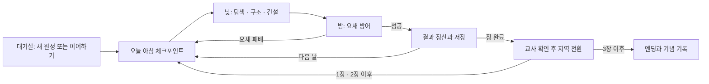

# 시즌2 개발계획

상태: 기획 가안 v0.1. 아래 코드 경로·데이터 형식·배포 구성은 **아직 구현되지 않았다**. 게임 규칙은 [게임기획](게임기획.md), 콘텐츠는 [18일 원정](18일-원정.md)을 따른다.

## 1. 이번 변경과 다음 구현의 경계

이번 변경은 `시즌2/`의 Markdown 문서뿐이다. `클로드/`와 `퀴즈나라/`, `.github/workflows/`, 실제 Firebase와 Cloudflare 설정을 바꾸지 않는다. 시즌2 실행 파일이나 시즌1 복사본도 아직 만들지 않는다.

기획 기준 main은 `89da73b`(시즌1 106차 병합)이다. 기준 게임 파일 SHA-256은 원본·배포용 모두 `91c2c21654161390e37d84b70c96d5736f56f07de0add7fea950a0ab15d1173f`다. 이는 이번 문서 작업의 비교 기준이며, 이후 사용자가 요청하는 시즌1의 독립적인 유지보수를 금지하는 버전 고정은 아니다.

| 대상 | 현재 | 시즌2 구현 원칙 |
|---|---|---|
| 실행 파일 | 시즌1 `클로드/index.html` | 시즌2는 별도 `시즌2/index.html`에서 시작 |
| 개발 코드 | 시즌1 단일 HTML 중심 | 시즌2 전용 모듈과 콘텐츠 데이터로 분리. 시즌1 파일을 런타임 의존성으로 참조하지 않음 |
| 배포 | 시즌1 Cloudflare `zombie-night` | 시즌2 전용 프로젝트·출력 디렉터리. 기존 프로젝트의 루트/출력을 교체하지 않음 |
| 온라인 방 | 시즌1 Firebase `sheepnight` 아래 | 시즌2 전용 `sheepnight_s2` 아래를 후보로 사용. 규칙·권한 범위를 실제 환경에서 확인 후 적용 |
| 브라우저 저장 | 시즌1 `nightRec102`, `gfxPick` 등 | 시즌2 키는 `zns2:` 접두사와 스키마 버전 사용. 같은 원점에서도 충돌하지 않게 분리 |
| 접속 버전 | 시즌1 기존 `GAME_VER` | 시즌2는 `season:2`, 빌드/통신 버전을 별도 검사 |
| 기념품 연동 | 시즌1 영구 클리어 기록 여부 미확인 | 최초에는 교사가 학급에 기념품을 지급하는 선택안. 자동 연동은 읽기 전용 명시적 가져오기부터 검토 |

재사용할 후보는 캐릭터·조작·전투·기본 건설·105차 UI 갱신 최적화·106차 건물 렌더링이다. 실제 구현 시 최신 시즌1을 검토해 이식 기준 커밋과 변경점을 기록한다. 공동 파일 추출을 위해 시즌1을 먼저 수정하지 않는다. 사용하지 않는 기존 경주/맵 전체를 시즌2에 그대로 띄우지 않는다.

## 2. 예정 파일 구성

다음은 이후 구현 단계의 구성안이다. 현재 존재하는 파일 목록은 [README](README.md)의 문서 목록이다.

```text
시즌2/
  README.md / AGENTS.md / 게임기획.md / 18일-원정.md / 개발계획.md
  index.html                  # 이후: 시즌2 입장·실행
  src/
    game/                     # 원정 상태·전투·건설·요새
    net/                      # 시즌2 방·호스트·재접속
    save/                     # 체크포인트·버전 변환
    ui/                       # 목표·자원·교사 화면
  content/                    # 날짜별 임무·지역·보스 정의
  assets/                     # 시즌2에서 사용하는 자산
  tests/                      # 상태·동기화·화면·성능 검증
  배포용/                     # 이후: 검수한 시즌2 출력
```

구체적인 번들러/빌드 도구는 첫 구현에서 정한다. 현재 문서 작업 때문에 기존 CI나 배포를 교체하지 않는다.

## 3. 차시·진행 상태



교사는 낮·밤 일시정지, 재개, 오늘 아침 재도전, 저장 후 수업 종료를 조작한다. 자동 다음 날 진행과 장 전환의 권한을 구분한다. 장 전환은 현장 건물 정산·저장 성공을 확인한 후 시작한다. 개인 장비·성장과 공동 자재·진행의 소유 범위는 게임기획의 경제 규칙에 맞춘다.

원정 전투 상태와 교실 관리 상태를 분리한다. 다른 학생의 재접속 때문에 모두의 밤 시간을 되돌리지 않는다. 접속이 늦은 학생은 현재 날의 요새 안전 지점에 합류하고, 현재 목표와 선택할 일을 짧게 안내받는다.

## 4. 저장·재접속과 지역 전환

| 저장 내용 | 용도 |
|---|---|
| `season`, `schemaVersion`, `buildVersion` | 다른 시즌/호환되지 않는 저장본을 구분 |
| `campaignId`, `checkpointId`, 장·날·기준 시드 | 새 원정과 이어하기, 같은 날 재시도 구분 |
| 요새 설비·주민·공동 자재·참가자별 장비/성장 | 다음 수업과 다음 장에서도 유지할 진행 |
| 현장 건물·임무 상태 | 같은 장 아침 체크포인트의 복원 |
| 정산 식별자와 적용된 결과 | 재접속·재시도로 보상/철거 환급이 중복되지 않게 함 |

위 필드명은 설계용이며 현행 시즌1에 존재한다는 뜻이 아니다. 실시간 전투를 동기화하는 방 상태와, 다음 수업에 읽는 확정 체크포인트는 구분한다. 프레임마다 전체 저장본을 쓰지 않는다.

- 아침 시작과 밤 성공 정산, 장 이동 직전에 체크포인트를 확정한다. 체크포인트 중간 값은 이어하기 목록에 노출하지 않는다.
- 교사가 낮·밤 중 ‘저장 후 종료’를 누르면 마지막 확정 아침/정산 지점을 표시한다. 그 이후의 미확정 전투는 다음 수업에서 다시 한다. 임의 시점 전투 전체 저장은 초기 범위에 넣지 않는다.
- 동일 브라우저 재접속 식별자는 시즌2 방 안에서 유지한다. 다른 기기로 옮겼을 때는 교사에게 기존 참가자 연결/새 참가자 중 선택하게 하고, 이름만으로 장비를 자동 합치지 않는다.
- 호스트가 끊기면 우선 방을 일시정지한다. 초기판은 교사 복귀 후 재개 또는 확정 체크포인트로 복구한다. 두 호스트가 동시에 보상/임무를 확정하지 못하도록 권한 세대를 구분한다.
- 불러오기 실패 시 빈 진행으로 덮어쓰지 않는다. 최근 정상 체크포인트와 원래 저장본을 남긴다. 교사 화면에 실제 저장 성공/실패·이어서 시작할 날을 표시한다.
- 장 전환은 입력 잠금 → 한 번만 정산 → 체크포인트 확정 → 이전 장 정리 → 다음 장 준비 → 준비된 참가자 재개 순서다. 모든 학생의 로딩을 무기한 기다리지 않으며 늦은 학생은 재접속 경로로 합류한다.
- 이전 장의 메시·전용 자원·충돌·길찾기·타이머·이벤트 구독을 정리한다. 공용 자산은 참조 중인 동안 유지한다. 준비 실패는 마지막 확정 체크포인트에서 재시도한다.
- 학년도/학급마다 새 `campaignId`를 만든다. ‘새 원정’이 다른 원정을 삭제하지 않게 한다. 시즌1 저장은 읽거나 지우지 않는다.

## 5. 개발 순서와 완료 기준

순서는 의존 관계이며 아직 일정이나 구현 완료를 뜻하지 않는다.

| 단계 | 만들 범위 | 완료 판단 |
|---|---|---|
| 0. 기획 정리 — 이번 작업 | 별도 폴더·문서·시즌1 보존 범위 | 문서 링크 정상, 시즌1/퀴즈나라 파일 차이 0 |
| 1. 독립 실행과 방 | 시즌2 입장, 같은 방 21명, 교사 일시정지, 기본 저장/재접속 | 시즌1 방·저장과 교차하지 않음. 새로고침과 호스트 단절 후 복구 확인 |
| 2. 숲 1~3일 시제품 | 고정 요새, 걷기/전투, 화살탑·얼음탑, 봉화 1곳, 주민 1명, 밤 방어 | 21명이 시작→3일 밤→결과까지 플레이. 실패/재시도/수업 중단 포함 검수 |
| 3. 숲 6일과 장 이동 | 첫 보스, 주민 설비, 현장 정산, 임시 다음 장으로 이동 | 회수/보상 중복 없음, 늦은 접속 복구, 이전 장 자원 정리 확인 |
| 4. 설원과 첫 조합 | 7~12일, 난로, 물+얼음 조합, 두 번째 보스 | 기존 규칙을 활용해 공략 가능. 추가 전투 규칙과 효과의 성능 확인 |
| 5. 도시와 엔딩 | 13~18일, 발전기, 치료 목표, 마지막 보스·공동 기념 | 임무 막힘 없이 완주, 반복 재도전에도 저장/보상 일관 |
| 6. 수업 검증과 배포 | 난도·시간 조정, 별도 배포, 교사 사용 안내 | 실제 수업 기기·네트워크 검증과 시즌1 회귀 확인 |

**첫 구현에 포함하지 않는 것:** 달리는 요새 위 전투, 절차적 무한 맵, 개인별 대규모 농장, PvP, 자동 시즌1 전투 능력 이전, 세 지역 동시 상주. 여기에 적은 후순위는 별도 요구가 생기면 재조정한다.

## 6. 21명·장시간 성능 계획

시즌1 실측에서 후반 GPU/JS 비용과 건축물 제출량이 함께 늘었다. 106차는 모의 장면에서 화면 밖 건물 제출을 줄였지만 실제 시즌2 FPS를 보장하는 결과는 아니다. 근거는 [106차 성능 검수](../깃허브에올릴것/106차-성능-검수.md)다.

- 한 번에 현재 지역만 활성화하고, 완료한 장의 건물은 경제 규칙에 따라 정산한 뒤 장면에서 정리한다.
- 타워 배치·화면 밖 건물·포탑 회전의 동작 보존을 확인하며 106차 묶음 렌더링을 이식한다. 물/얼음 연쇄 효과는 프레임마다 모든 타워 쌍을 검사하지 않는다.
- 자원과 임무 UI는 값이 달라질 때 갱신한다. 일상적인 HUD에 반복 깜빡임·큰 투명 효과를 추가하지 않는다.
- 초기 부하 장면은 21명, 타워 40개, 벽 80개, 적 40마리로 제안하고 적 60마리/전체 타워 사격도 별도로 확인한다. 이 수는 **검사용 출발점이며 플레이 상한 확정값이 아니다**. 실제 최종 건설 한도와 비용은 검증 후 함께 정한다.
- 화질은 시즌1과 같은 조건으로 비교한다. 모델·해상도를 임의로 낮춰 목표를 달성했다고 하지 않는다. 안개·눈·치료 광선은 시야를 가리지 않게 만들고 비용을 따로 측정한다.
- 원정 1일/6일/12일/18일과 반복 장 이동 후 FPS, 프레임 시간, JS/GPU, 호출·삼각형, 건물/타워/적 수, 활성 장 자원과 통신량을 기록한다. 메모리는 브라우저가 제공하는 범위에서 전후 추세를 함께 본다.
- 성능 목표 가안은 21명 대표 전투 평균 50fps 이상, 1% low 30fps 이상이다. 1% low는 프레임 시간 전체 표본으로 산출하며 기존 5초 간격 밤 기록으로 대신하지 않는다. 목표 통과 여부는 실제 LG gram 수업 조건에서 판정한다.

## 7. 확인 시나리오

| 범위 | 확인할 동작 |
|---|---|
| 시즌 분리 | 같은 숫자 방 코드로 S1/S2를 열어도 서로 보이지 않음. S2 새 원정/불러오기/기념품 지급이 S1 저장을 바꾸지 않음 |
| 협동 인원 | 1명 개발 검사, 5명 모둠 검사, 21명 교실 검사. 결석·중도 이탈·늦은 입장으로 필수 임무가 잠기지 않음 |
| 경제 | 마지막 자재를 동시에 사용, 업그레이드 후 장 이동, 철거/정산 재요청, 저장 후 재입장에서도 중복 지급/음수 자재 없음 |
| 실패/저장 | 개인 쓰러짐, 요새 패배, 보스 재시도, 저장 실패, 브라우저 종료, 다른 기기 복귀, 호스트 단절 |
| 화면·조작 | 기본 시점에서 적 예고와 목표가 보임. 작은 UI와 키보드/터치 동작. 안개·눈 때문에 목적지나 적을 놓치지 않음 |
| 지역 전환 | 일부 클라이언트 로딩 지연/실패, 전환 중 재접속, 반복 전환 후 중복 NPC·리스너·길찾기·타이머가 남지 않음 |
| 수업 운영 | 시작 안내→1~3일 완주→저장 후 종료→다음 수업 이어하기를 교사가 실제로 수행 |

기획 문서 단계에서는 링크·문서 일관성·변경 경계만 확인한다. 아직 없는 게임에 대해 화면·완주·성능 검사를 통과했다고 쓰지 않는다.

## 8. 배포와 교사 안내

시즌2가 실행 가능해지면 별도 Cloudflare Pages 프로젝트를 연결하는 안을 검토한다. 예정 루트는 `시즌2`, 출력은 `배포용`이며, 실제 빌드 방식과 프로젝트 이름·주소는 구현 때 정한다. 시즌1의 `zombie-night` 설정과 감시 경로는 유지한다.

교사 안내에는 두 시즌의 주소, 새 원정/이어하기, 클래스별 저장 선택, 기념품 지급, 실패 재도전, 연결 끊김 복구를 담는다. 같은 시즌의 선생님과 학생이 같은 호환 버전으로 입장하는지 확인한다. 통합 시즌 선택 화면은 별도 진입 페이지로 검토하고 시즌1 원본은 그대로 둔다.

이번 기획 PR은 시즌2 게임 배포가 아니다. Windows 바탕화면에 전달할 새 실행 파일도 없으므로 기존 시즌1 배포본을 교체할 작업은 없다.
