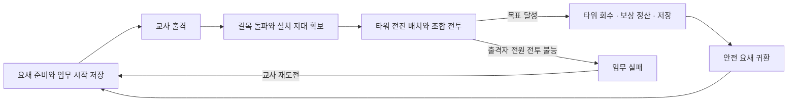

# 시즌2 개발계획

상태: 확장 기획 v0.3 및 첫 보스 테스트판 s2-001. 사용자 확정 방향은 **새로운 타워 조합과 강한 보스를 공략하는 공격형 원정**이다. 규칙은 [게임기획](게임기획.md), 콘텐츠는 [18일 원정](18일-원정.md), 조합은 [타워·보스 설계](타워-보스-설계.md)를 따른다. 실제 구현 범위는 [구현·검수 기록](s2-001-구현검수.md)을 우선한다.

최우선은 **마을·사냥터・타워맵 디자인, 효과음·배경음, 성능 최적화**다. [맵·소리·성능](맵-소리-성능.md)의 작은 원정 한 바퀴를 실제 미술·소리·21명 부하로 먼저 검증하고, 그 뒤 임무 수를 늘린다. 콘텐츠 분량을 늘리는 것으로 이 기준을 대체하지 않는다.

## 1. 시즌1 보존과 개발 범위

작업 범위는 `시즌2/` 코드·문서·독립 실행 파일이다. `클로드/`, `퀴즈나라/`, 실제 Firebase 보안 규칙·Cloudflare 배포 설정은 변경하지 않는다. 대기실부터 첫 보스까지 한 원정을 실행하는 s2-001을 먼저 구현한다.

시즌1 기준은 106차이며 원본·배포용 SHA-256은 `91c2c21654161390e37d84b70c96d5736f56f07de0add7fea950a0ab15d1173f`다. 시즌1에 대해 사용자가 별도로 요청하는 유지보수까지 금지하는 버전 고정은 아니다.

| 대상 | 시즌2 구현 원칙 |
|---|---|
| 실행 | 별도 `시즌2/index.html`과 전용 모듈. 시즌1 실행 파일을 런타임 의존성으로 참조하지 않음 |
| 배포 | 시즌2 전용 프로젝트·출력 경로. 시즌1 `zombie-night`의 루트·출력을 교체하지 않음 |
| 온라인 방 | 기존 서버의 전용 예약 경로 `sheepnight/season2_v1/rooms/<코드>`. 시즌1 대문자 방과 분리. 최초 후보 `sheepnight_s2`는 권한 미지원으로 사용하지 않음 |
| 브라우저 저장 | `zns2:` 접두사·스키마 버전으로 분리. 시즌1 `nightRec102` 등은 읽거나 지우지 않음 |
| 접속 구분 | 시즌 번호·빌드/통신 버전 검사. 같은 숫자 방 코드라도 서로 다른 시즌 방에 접속하지 않음 |
| 클리어 기념품 | 시즌1 영구 기록 여부 미확인. 초기에는 교사 지급 가안, 자동 연동은 후속 검토 |

시즌1의 캐릭터·조작·기본 전투·타워 모델과 105~106차 최적화는 재사용 후보로 검토한다. 이식 기준 커밋과 변경점을 기록하며, 공통 코드 추출을 위해 시즌1을 먼저 리팩터링하지 않는다. 시즌1의 성문·수정 방어와 거대한 맵 전체를 시즌2에 그대로 띄우지 않는다.

[시즌1 재사용계획](시즌1-재사용계획.md)에 실제 함수·검사 위치를 정리했다. 106차 타워 렌더링뿐 아니라 기존 소리의 음량 분리·거리 처리·동시 발음 제한도 활용한다. 새 마을/숲 배치·전진 모듈·조합·보스·저장은 원정에 맞게 설계한다.

## 2. 예정 파일 구성

아래는 전체 확장의 구성안이다. 첫 테스트판은 `src/`의 `app/sim/scene/avatar-season1/net/audio/perf/ui/content` 모듈로 분리했으며, 아직 아래 세부 디렉터리 전부를 만들지 않았다. 현재 상태는 [README](README.md)에서 확인한다.

```text
시즌2/
  index.html              # 이후: 입장·실행
  src/game/               # 원정·타워 모듈·조합·보스
  src/net/                # 별도 방·호스트·재접속
  src/save/               # 확정 체크포인트·버전 변환
  src/ui/                 # 원정 목표·모듈·교사 화면
  content/                # 지역·설치 지대·임무·보스 정의
  assets/                 # 시즌2 자산
  tests/                  # 상태·통신·화면·성능 검사
  배포용/                 # 이후: 검수한 실행 출력
```

빌드 도구와 배포 프로젝트 이름·주소는 첫 구현에서 정한다. 기존 CI는 이번 문서 작업으로 변경하지 않는다.

## 3. 원정 상태와 승패



요새·문·수정·봉화·난로·발전기의 체력을 지키는 승패 목표는 없다. 보스 제압이나 치료 등 그 임무의 명시된 목표로 승리한다. 낮·밤 생존 타이머로 자동 성공하지 않는다.

개인 쓰러짐은 구조·복귀 규칙을 적용한다. 현재 접속 중인 출격자 전원이 동시에 전투 불능이면 임무 실패다. 접속자가 모두 끊겼거나 교사 호스트가 끊긴 경우는 일시정지하며, 실패로 오판정하지 않는다. 현재 임무 참가자와 대기실 참가자를 구분한다.

## 4. 타워를 복제하지 않고 이동하기

타워 모듈에는 고유 ID, 종류, 관리 모둠, 현재 체력·강화, 실제 지출, 현재 상태를 둔다. 상태 예시는 `재고 / 설치 중 / 배치 / 포장 중 / 운반 / 파괴`이며 필드명은 설계 가안이다.

- 포장 3초·설치 2초를 첫 실험값으로 둔다. 포장 시작부터 사격을 멈추며, 취소 시 상태를 일관되게 복원한다.
- 같은 모듈을 이동하므로 체력·강화가 유지되고 자재 지급이나 새 건설 경험치가 생기지 않는다.
- 관리 모둠과 교사만 해당 탑의 포장을 시작한다. 여러 학생의 동시 요청 중 한 요청만 확정한다.
- 봉화 등으로 확보한 청색 설치 지대 안에서 위치를 선택한다. 적이 차지한 구역·보스 통행을 막는 위치·겹친 위치에는 설치할 수 없다.
- 첫 시제품에는 벽 건설을 넣지 않는다. 사거리·지형·타워 조합과 지원으로 공략한다.
- 임무 성공이나 장 전환에서 생존 모듈은 중복 없이 재고로 자동 회수하고 이전 현장 객체를 제거한다. 장 이동에 자재 환급을 적용하지 않는다.
- 파괴 모듈은 그 전투에서 포장하지 못한다. 귀환 뒤 공동 수리 정책을 적용하며, 폐기 환급은 실제 지출 기준으로 별도 처리한다.
- 운반자 접속 끊김은 안전한 회수 상태로 바꾸어 다른 관리 모둠원이 이어받게 한다. 바닥 객체와 재고에 같은 모듈이 동시에 생기지 않게 한다.

## 5. 저장과 재접속

| 확정 저장 내용 | 목적 |
|---|---|
| 시즌·스키마·빌드 버전, 원정/학급 ID | 다른 시즌·학급·호환되지 않는 저장과 구분 |
| 임무 번호·시드·체크포인트 ID | 같은 임무 시작으로 재시도 |
| 참가자별 장비·성장, 공동 자재, 주민·요새 설비 | 원정 간 유지할 진행 |
| 모듈 ID별 상태·체력·강화·지출 | 이동·파괴·회수의 일관성 |
| 정산/보상 식별자 | 임무 재입장·재시도에서 중복 지급 방지 |

임무 시작, 성공 정산, 장 전환 완료를 하나의 일관된 상태로 확정한다. 프레임마다 전체 저장본을 쓰지 않는다. 실패 시 그 임무 시작 상태 전체를 복구하여 실패한 시도의 소비와 보상이 섞이지 않게 한다.

일반 재접속은 현재 방의 최신 전투 상태에 합류하며, 개인 재접속으로 전원을 임무 시작으로 되돌리지 않는다. 다른 기기 접속은 이름만으로 자동 합치지 않고 교사에게 기존 참가자 연결을 제공한다.

‘저장 후 종료’는 마지막 확정 지점부터 이어짐을 알린다. 임의 프레임의 전투를 그대로 저장하는 기능은 후속이다. 중간 저장 실패 시 정상 저장본을 덮어쓰지 않고, 교사에게 실제 복구 가능한 임무를 보여 준다.

장 전환은 정산 확정 → 기존 장 정리 → 새 장 준비 → 재개 순서다. 지연된 학생은 안전한 최신 전진 지점으로 합류하며 전원 로딩 완료를 무기한 기다리지 않는다. 호스트의 단일 권한 세대와 정산 ID로 두 호스트의 중복 확정을 막는다.

새 학년도·학급의 새 원정은 별도 ID로 시작한다. 다른 원정이나 시즌1 저장을 삭제하지 않는다.

## 6. 구현 순서와 완료 기준

| 단계 | 범위 | 확인할 결과 |
|---|---|---|
| 0. 기획 — 현재 | 별도 문서·공격형 원정·타워/보스 가안 | 링크·규칙 일치, 시즌1 변경 없음 |
| 1. 독립 실행 | 시즌2 입장·21명 방·저장·교사 일시정지 | 시즌1과 통신/저장 분리, 새로고침·호스트 단절 복구 |
| 1.5. 대표 장면 | 작은 마을·숲 한 구간·타워 전진 배치·귀환, 실제 미술과 소리 | 기본 카메라 동선·타워 구별·음악 전환, 21명 부하와 반복 왕복 확인 |
| 2. 숲 1~3일 | 화살·얼음·쇄빙 하나, 포장/전진 배치, 봉화·주민 각 하나 | 길목→조합→구조 완료, 모듈 보존·실패 재도전·동시 요청 검증 |
| 3. 숲 4~6일 | 첫 강한 보스와 장 전환 | 돌진 예고·경직 공략, 탑 회수·이전 장 정리 |
| 4. 설원 | 물탑·빙결지대, 난로·얼음 보스 | 조합 배치 선택, 보스 무한 감속 방지 |
| 5. 도시 | 전기탑·연쇄전격, 발전기·치료 보스·엔딩 | 효과 재귀 없음, 기본탑 대안과 치료 목표 검증 |
| 6. 교실 검수·배포 | 실제 기기·21대 연결·수업 시간, 별도 배포 | 완주·재접속·성능·시즌1 보존 확인 |

첫 단계에서 무한 맵, 달리는 요새 전투, 모든 원소 조합, PvP, 시즌1 전투력 자동 이전을 함께 만들지는 않는다. 후속 범위는 실제 플레이 결과와 사용자 요구로 조정한다.

마을·숲 대표 장면의 배치 검토는 독립 실행 기반과 함께 진행한다. 1.5단계에서 필요한 타워 포장·설치를 먼저 연결하고, 2단계에서 쇄빙·봉화·구조와 세 임무를 완성한다. 대표 장면은 별도 콘텐츠를 추가하는 단계가 아니라 첫 시제품의 품질을 먼저 확인하는 단계다.

## 7. 성능과 검수

[106차 성능 검수](../깃허브에올릴것/106차-성능-검수.md)의 건물 묶음 렌더링을 참고한다. 시즌1에서 측정한 제출량 절감을 시즌2의 실제 FPS 보장으로 해석하지 않는다.

- 한 번에 현재 지역을 활성화하고 완료한 장의 메시·충돌·길찾기·타이머·구독을 정리한다. 공유 자산은 사용 중이면 유지한다.
- 조합은 공격 적중과 적 상태로 판정한다. 매 프레임 모든 타워 쌍을 검사하지 않는다. 추가 피해가 다른 조합을 재귀적으로 발동시키지 않게 한다.
- 포장/설치·피해 색·타워 회전·시야 밖 객체를 기존 묶음에 반영하되 그리기 호출 증가를 함께 확인한다.
- 초기 부하 시험은 21명·40타워·적 40마리에서 시작해 적 60마리와 동시 조합 발동도 확인한다. 숫자는 시험 출발점이며 게임 상한 확정값이 아니다.
- 전진 거리·1/6/12/18임무·반복 장 전환에 따라 FPS·프레임 시간·JS/GPU·호출·삼각형·모듈 수·효과 수·통신량을 기록한다.
- 동일 화질의 실제 LG gram에서 대표 전투 평균 50fps 이상·1% low 30fps 이상을 목표 가안으로 검증한다. 1% low는 전체 프레임 시간으로 계산하며 간격을 둔 성능 표본으로 대신하지 않는다.
- 같은 방의 학생 1/5/21명, 늦은 입장, 포장자 이탈, 동시 설치, 파괴 직후 회수, 전원 쓰러짐, 전원 연결 끊김을 구분해 확인한다.
- 기본 시점에서 공격 예고·적·설치 지대가 보이는지 직접 플레이한다. 초등학교 3학년이 조합의 원인과 타워를 옮기는 이유를 이해하는지 관찰한다.

문서 단계의 검증은 링크·일관성·변경 범위다. 실제 시즌2 화면·완주·FPS를 검증했다고 보고하지 않는다.

## 8. 배포

시즌2 실행이 준비되면 별도 Cloudflare Pages 프로젝트의 루트 `시즌2`, 출력 `배포용` 구성을 검토한다. 실제 빌드 방식·주소는 구현 때 정하며 기존 `zombie-night` 설정은 유지한다.

교사 안내에는 시즌별 주소, 새 원정/이어하기, 출격·재도전, 모듈 회수·파괴 수리, 연결 복구를 담는다. 통합 시즌 선택 화면은 후속 별도 진입 페이지로 검토한다.

이번 문서 PR은 게임 배포가 아니다. Windows 바탕화면에 전달할 새 실행 파일도 없으므로 기존 시즌1 배포본을 교체하지 않는다.
