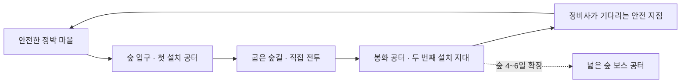

# 시즌2의 최우선 제작 기준 — 맵·타워·소리·성능

2026-10-13 · 기획 가안 · 구현 전

사용자는 **마을·사냥터 맵 디자인, 타워맵 디자인, 효과음·배경음, 성능 최적화**를 가장 중요한 우선순위로 지정했다. 아래는 이를 구체화한 제안이다. 타워맵은 타워 외형과 타워를 배치하는 전투 공간을 함께 설계한다. 타워 조합·보스 중심의 공격형 원정과 시즌1 보존 원칙은 유지한다.

## 1. 먼저 완성할 작은 장면

18개 임무를 넓히기 전에 **마을 출발 → 숲길 전투 → 탑 전진 배치 → 귀환** 한 바퀴의 화면·소리·성능을 확인한다. 회색 임시 도형으로 동선을 검증한 뒤, 이 한 바퀴에 실제 사용할 미술과 소리를 입힌다. 다음은 첫 숲 지역의 공간 구성안이며, 아래 장소를 전부 동시에 렌더링해야 한다는 뜻은 아니다.

사냥터는 임무를 수행하는 숲 전투 지역이다. 첫 시제품에 별도 무한 사냥·파밍 모드를 추가하지 않는다. 1~3일 임무마다 필요한 구간을 열고, 완료 후 안전 마을로 돌아온다. 이후 보스 공터를 붙인다.

## 2. 마을 — 돌아왔을 때 달라지는 따뜻한 장소

요새가 정박한 작은 마을을 준비·보급·귀환 공간으로 삼는다. 중앙에는 공동 광장, 한쪽에는 타워 작업장, 맞은편에는 주민 천막, 진행 방향에는 숲 출구를 둔다. 중앙에서 작업장과 출구의 간판이 보이게 하고, 21명이 겹치지 않고 흩어질 여유 공간을 확보한다.

- **첫 인상:** 따뜻한 석재·목재·천막, 둥근 지붕과 처마, 천의 두께와 주름, 금속 테두리. 상자만 쌓은 건물 외형을 피한다.
- **길 안내:** 깃발·바닥 포장·간판 형태가 출구로 이어진다. 이동을 막는 장식과 장식처럼 보이는 충돌벽을 만들지 않는다.
- **성장 보상:** 정비사 구조 후 빈 천막에 작업대·공구·등불이 생긴다. 첫 시제품에서는 이 변화 하나부터 실제로 보이게 한다.
- **안전:** 마을·문·수정을 지키는 전투는 없다. 원정 준비가 끝나면 교사가 출격한다.

## 3. 사냥터 — 싸우기 전에도 길이 읽히는 숲

숲 입구는 밝고 넓게, 굽은 길은 바위와 나무로 방향을 잡고, 봉화 공터는 탁 트이게 만든다. 먼 배경은 숲의 깊이를 표현하되 가까운 적·동료·탑을 가리지 않는다. 짙은 안개로 적을 숨기는 연출은 첫 시제품에서 피한다.

| 구간 | 공간 디자인 | 플레이 판단 |
|---|---|---|
| 입구 공터 | 넓은 평지, 낮은 바위, 눈에 띄는 첫 설치 표지 | 화살탑을 펼치고 사거리 확인 |
| 굽은 숲길 | 완만한 굽이, 좌우 회피 여유, 다음 봉화가 보이는 틈 | 직접 전투로 앞길을 확보하고 뒤의 탑을 옮길 시점 선택 |
| 봉화 공터 | 넓은 중앙 길과 서로 다른 측면 설치 지대 | 얼음·화살 사거리를 겹치거나 넓게 분산 |
| 정비사 접근로 | 짧은 마지막 전투, 분명한 안전 지점 | 친구들과 길을 열고 주민에게 도달 |
| 후속 보스 공터 | 중심 이동 공간, 넓은 측면 배치 지대, 막다른 곳 최소화 | 돌진을 옆으로 피하고 경직 때 집중 공격 |

탑과 학생이 반드시 한 줄로 지나가야 하는 좁은 목을 만들지 않는다. 기본 플레이 카메라로 출발점·굽이·설치 지대·보스 예고를 확인한다. 조망용 사진만으로 맵 완성을 판단하지 않는다.

## 4. 타워 외형과 배치 공간

화살탑은 목재·금속의 가는 발사대와 움직이는 활대, 얼음탑은 둥근 받침과 반투명 얼음 핵으로 구별하는 안이다. 시즌1 모델을 출발점으로 쓰되, 축소된 기본 시점에서 **윤곽·발사 동작·소리**만으로 두 종류를 구별할 수 있어야 한다. 얼음 핵의 투명 면·빛·입자를 겹겹이 늘리지 않는다.

- 설치 지대는 청색 경계에 깃발·바닥 무늬·‘설치 가능’ 표시를 함께 쓴다. 잠긴 지대는 봉화 그림과 개방 조건을 보여 준다.
- 지대 안의 위치는 자유다. 중앙 통로·부활 위치·보스 이동 공간은 설치 대상에서 제외하고, 거절 이유를 미리보기에서 알려 준다.
- 배치 중인 탑과 선택한 탑의 사거리만 우선 표시한다. 모든 탑의 원을 항상 겹쳐 그리지 않는다.
- 포장하면 같은 탑임을 알아볼 수 있는 운반 꾸러미가 되고, 재설치하면 기존 체력·강화를 유지한다.
- 쇄빙은 짧은 얼음 파열과 구별되는 타격음으로 알린다. 모든 학생 화면에 큰 글씨·섬광을 계속 띄우지 않는다.

## 5. 소리 — 장면의 분위기와 전투 정보

| 장면·행동 | 소리 방향 | 반드시 전달할 정보 |
|---|---|---|
| 안전 마을 | 부드러운 현·목관 계열의 짧은 반복 선율, 드문 작업장·바람 소리 | 귀환해 정비하는 편안함 |
| 숲 탐색 | 마을 선율을 잇는 가벼운 리듬, 절제된 새·나뭇잎 소리 | 전진하는 분위기와 가까운 적의 위치 |
| 일반 전투 | 탐색 음악에 긴장 리듬을 부드럽게 더함 | 공격·피격음을 덮지 않음 |
| 설치·포장 | 조립 걸쇠 / 묶는 천 / 완료음 구분 | 작업 시작과 완료, 취소 구별 |
| 화살·얼음·쇄빙 | 짧은 활시위 / 차가운 결정음 / 한 번의 파열음 | 어떤 탑이 공격했고 조합이 발동했는지 |
| 후속 보스 | 낮은 박동과 전투 선율, 공격 예고는 별도 짧은 음 | 피해야 할 순간과 공격할 빈틈 |
| 목표 완료·귀환 | 짧은 해결 선율 뒤 마을곡으로 전환 | 성공·정산·귀환의 구분 |

시즌1의 합성음 재생·음량 분리·거리 감쇠·배경음 전환·동시 발음 제한을 우선 이식한다. 기존 곡을 무조건 최종 음악으로 확정하지 않고, 실제 짧은 샘플을 들어 시즌2 분위기에 맞춰 선율·음색을 다듬는다. 외부 음원을 채택할 경우 출처·이용 조건도 자산에 기록한다.

배경음·효과음 음량을 따로 조절하고 교실의 21대 동시 재생을 확인한다. 공격 예고·구조 요청을 일반 연사음보다 우선 처리하고, 같은 위치의 중복 타격음은 제한한다. 중요한 정보는 화면에도 보여 무음에서도 공략할 수 있게 한다. 탭 이탈·교사 일시정지·장 전환 때 이전 소리가 쌓이지 않아야 한다.

## 6. 성능을 맵 제작과 함께 확인하기

106차의 타워 묶음 렌더링·시야 밖 건물 제외·변경분만 갱신하는 방식을 이식 후보로 삼는다. 나무·바위·장식은 반복 자산을 공유하고 구역별로 관리한다. 현재 지역 중심으로 활성화하며, 새로 추가할 원거리 장식의 세부 묘사 수준을 정한다. 공격 예고·적 윤곽·필수 표지는 줄이지 않는다.

화질을 임의로 낮추어 성능 개선으로 보고하지 않는다. 같은 기기·해상도·화질·카메라·전투 부하에서 변경 전후를 비교한다. 이전 시즌의 감소율을 시즌2의 FPS 증가율로 쓰지 않는다.

| 확인 장면 | 함께 확인할 내용 |
|---|---|
| 마을 21명 집결 | 길·간판 가독성, 캐릭터 가림, 프레임 시간 |
| 숲 전진과 탑 이동 | 설치 지대·통로, 재설치 순간 끊김, 타워 중복 없음 |
| 21명·40탑·적 40→60마리 시험 | 조합 연속 발동의 JS/GPU·그리기 호출·삼각형·효과 수·통신량·오디오 노드 수 |
| 마을↔숲 반복 왕복 | 남은 메시·타이머·구독·오디오 노드, 메모리·지연의 지속 증가 여부 |

수량은 부하 시험 가안이며 게임 상한이 아니다. 실제 LG gram에서 대표 전투 평균 50fps·1% low 30fps 이상을 목표 가안으로 둔다. 전체 프레임 시간을 모아 측정하고, 실제 21대 연결 검증을 별도로 기록한다. 자동 검사·스크린샷·소리 직접 듣기·실기기 성능 확인을 각각 남긴다.

## 7. 확장 전 확인 순서

1. 마을·숲 한 구간의 동선과 기본 시점 가독성을 확인한다.
2. 실제 타워 외형·재질·배치 표시·마을곡·탐색곡·핵심 효과음을 붙인다.
3. 21명 부하에서 이동·전투·재설치·소리가 함께 돌아가는지 확인한다.
4. 이 기준을 만족한 뒤 숲 1~3일을 마무리하고, 숲 보스와 다른 지역을 확장한다.

현재는 설계만 작성했다. 새 맵·타워 외형·음원·실기기 성능 결과는 아직 없다. 재사용할 실제 코드와 이식 주의점은 [시즌1 재사용계획](시즌1-재사용계획.md)을 따른다.
